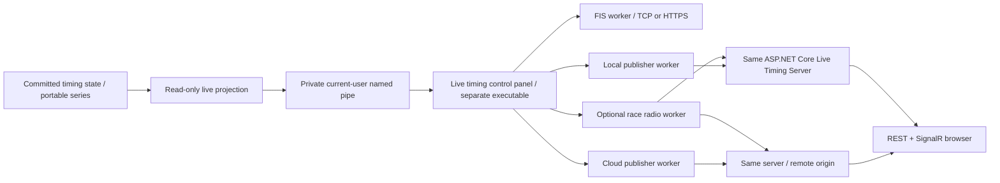

# Live timing

OpenSkiTime supplies three independent downstream channels: FIS Live Timing, Standalone Local and Standalone Cloud. Local and Cloud run exactly the same .NET 10 ASP.NET Core server. Cloud is tested locally in this development phase; Azure resources and DNS have not been deployed.

## Operator workflow

Open a saved timing run. The timing connection row shows compact **Local**, **Cloud** and **FIS** indicators: green means Running, red means Starting, Reconnecting or Error, and pale means Stopped. Hover an indicator for the full state, endpoint, last successful publish, error and expiry. **Live timing…** launches `OpenSkiTime.LiveTiming.ControlPanel.exe` in its own window without taking focus from timing. Pressing the button again restores and activates the existing panel. All channels may run together; FIS requires an alpine FIS competition with a numeric codex, password and complete racer FIS codes/nations.

The control panel uses the OpenSkiTime navy and blue palette with separate publishing-channel cards and connection-settings cards. Both columns scroll vertically in smaller windows. Sharing and deletion controls appear when a standalone session has a public URL. Settings apply on Start; Refresh also requests a fresh race snapshot with the chosen time zone.

Closing the panel stops its publishers and local server. Ending only `OpenSkiTime.LiveTiming.ControlPanel.exe` in Windows Task Manager also stops the whole live timing process tree. Authoritative timing capture continues in OpenSkiTime. Reopen the panel and press Start to resume. Cloud can reuse its retained valid session; a new panel has a new Local server and creates a new Local URL. A forced exit does not send a public pause message. Use Stop when the public session should explicitly show Paused. The executable can also be opened directly, but it needs the timing application's button to establish a race connection.

Set the race's time zone (Windows or IANA ID, e.g. `Europe/Helsinki`), endpoints and FIS transport/password. Defaults are local `http://localhost:5078`, FIS TCP `live.fis-ski.com:1550` and HTTPS `https://livedata.fis-ski.com/al/`. The cloud default `https://live.openskiti.me` is a future deployment address; replace it with a local cloud simulation URL now.

| Control | Behavior |
|---|---|
| Start | Starts/restarts the channel worker. Local additionally starts its server process. Creates a session if needed, sends a full snapshot and then publishes changes. A valid cloud credential preserves the URL. |
| Stop | Stops publishing; standalone keeps the last state publicly visible with a paused banner. Server/session and credential remain available for resume. FIS sends no more updates/keepalives. |
| Refresh | Resumes the worker and replaces server state with the latest authoritative snapshot; no dependency on queued historical events. |
| Delete session | Stops publishing and removes the session's state. The old URL displays unavailable. Start creates a new URL. |
| Delete All Data | Explicit data-removal action: identical full-session removal in this RAM-only server, including all competitors, lists, results, intermediates and state. It is separate from Stop. |
| Copy URL / Open URL | Shares or opens the public standalone view. Credential is never in the public URL. |

Changing competitions stops the publishers for the previous competition. Changing runs within the same competition retains prior runs and publishes the new current run. Edit endpoint/transport settings and press Start to replace that channel's process. A failed delete is reported as an error and stops further publishing; reconnect to the endpoint and retry deletion. A successful delete is shown only after its HTTP response.

The page starts with one compact bar: the competition name with place, discipline and date under it, and on the right the last update time, the connection state (a dot with Live, Connecting or Reconnecting) and the run, split-time and radio selectors. The product name is in the browser tab title, not on the page. Below the bar, the banner follows the course from top to bottom, one row per racer with a pictogram, bib, name, nation (flag over code), time and rank: the next two racers in the start gate of the current run, the racer after next on top and the next racer just above the course (start wand pictogram; the racers still waiting after the furthest racer who has started, then any racer who missed their turn; a DNS or NPS marked ahead of time does not count as a start), every racer on course in course order, the racer who started last on top and the first one nearest the finish (skier pictogram, blue) with a **running time** (m:ss.t) that ticks ten times a second in the browser from the published start instant, and the **last finisher** of the current run (finish flag pictogram, green) with run time, total time from Run 2 on, and rank as `#n`, so a slow time that ranks low in the list is still visible; a DNF or DSQ is shown there with its status when it is the latest outcome. Racers on course have the ticking running time in the results list too. The running time is a display estimate based on the viewer's clock. When the published start instant is missing or implausible for that clock at the moment the viewer first sees the racer on course (more than five seconds ahead or ten minutes back, for example a device clock or date that differs from real time), it runs from that moment instead, so a racer on course always has a ticking time. The origin is chosen once per racer and run, so the time never jumps. A completed run, a stopped publisher and a stale state are announced above the rows. When the last finisher changes, it is highlighted for ten seconds in the banner and in the results list (not on the first view of the page). The last finisher is the racer with the latest device finish timestamp (compared at full 100 ns precision) when every candidate has one; otherwise each finisher is placed at its finish instant (start instant plus the device start-to-finish difference, which no correction moves, or plus the run time when the impulses are not published) and a DNF or DSQ at its publish time. A corrected older result does not replace it. The browser shows competition/place/discipline/run, competitors, bib/name/nation/club, split times, finish/rank/difference, racers on course and the last live update. There is no status column: the run's time column shows DNS, DNF, DSQ or NPS instead of a time, and a racer on course has the ticking running time there (in Run 2 the Run 2 column says DNF while the Run 1 column keeps its time). The nation column shows the three-letter FIS code with the country's Unicode flag (the regional-indicator pair of the matching ISO 3166 code, `live-nations.js`) and the English country name as tooltip. Where the platform draws such flags as two letters, as Windows desktop browsers do, the page detects it and draws them with the bundled *Twemoji Country Flags* font (`wwwroot/fonts`, about 80 kB, loaded only by such browsers and cached for a day; see THIRD-PARTY-NOTICES.md). When every racer has the same nation (or none), nations are not shown at all: no column, nothing in the banner and no nation statistics. The club has its own column on wide screens. Screens up to 640 px wide get two- and three-line cells instead of the wide table, so a phone needs no sideways scrolling: rank over bib (over places gained from Run 2 on), last name over first name over flag, nation code and club, intermediate times one per line, Run 1 over Run 2 and total over difference (in Run 1, time over difference). A time rank that does not fit beside its time wraps under it. Under the results, **Race statistics** gives the number of racers, nations and clubs, and per run the starters, finished, DNS, DNF and DSQ (with NPS, on course, under review and still to start when there are any); **Racers by nation** and **Racers by club** open on click and stay open across updates. Each nation and club there is a button that adds it as a filter chip above the results and scrolls them into view; selecting it again, or the chip's ✕, removes it. Above the results, a search field filters while typing: every word must occur in the racer's last or first name, club, nation code or English nation name (ignoring case, accents and extra spaces), and digits alone find that bib. **Enter** or **+ Filter** keeps the search as a chip and empties the field for the next one; **Clear all** removes every chip. Chips of one kind are alternatives (two nations show the racers of both, two searches both racers); the typed search, each kind of chip and **★ Favorites** (only the viewer's favorite racers) must all match. The count of shown racers is given beside them. Filters only hide rows: rank and difference stay those of the whole race, and the banner is not filtered. The filter lasts for the open page, and the search keeps its text and focus through live updates. Each results row starts with a star that makes the racer a favorite (`live-favorites.js`). Favorites are stored only in that browser's local storage (`openskitime.live.favorites`, at most 200, validated on read; not a cookie and never sent to the server) and apply in every tab, also tabs already open. A favorite keeps the racer's FIS code, name, nation and club; in another race it is the competitor with the same FIS code when both have one, otherwise with the same last and first name (ignoring case and extra spaces). While the browser has favorites, the front page lists them above the races with their results in every race the server publishes (each run's time or status and rank, and from Run 2 on the combined time and rank), reading the public state of each listed race with the race list every 30 seconds; a star there removes the favorite. The footer shows how many viewers watch the race now (**n watching live**), this one included: the server sends the count on watching and then every change within five seconds (see `Viewers` below); it is hidden while the viewer is not connected. Split times have one column each. The viewer chooses **Intermediate times** (cumulative from the start: Intermediate 1, Intermediate 2, …) or **Sector times** (Sector 1 is start to Intermediate 1, each next sector runs to the next intermediate, and the last sector runs from the last intermediate to the finish, so there is one sector more than intermediates). A sector is blank unless both of its timing points have a time, so a missed intermediate never merges two sectors. The browser derives sectors from the published cumulative splits; the choice is remembered in that browser's local storage and applies to all races. From Run 2 on, each earlier run has its own column (**Run 1**, showing the time or the DNF/DSQ/DNS status), the current run's time column is labelled **Run 2**, a **Total** column shows the combined time, and rank and difference follow the combined standings, as in the timing view's Run 2 ranking. Every time is followed by its rank at that point in brackets, the fastest in bold: an earlier run's time and, from Run 2 on, the current run's time by the published run rank; each intermediate and sector time by its rank among the times of the run at that point, computed in the browser from the published hundredths (equal times share a rank, the next one is skipped). The time the Rank column already ranks (the Run 1 finish time, the total) has no bracket. From Run 2 on, a **+/−** column after Total (the "Pr" column of FIS live timing; its heading explains it on hover) shows the places gained since the standings after the previous run (Run 1 rank, later the previous combined rank), measured against the racer's **provisional** standing so it moves with every finish while the run is going: one plus the finishers with a better combined time plus the racers who were ahead after the previous run and have not finished this run yet (to start, on course or under review), as if those still to come stay ahead. A racer passed by someone who was ahead after Run 1 therefore keeps their value; one passed by someone who was behind loses a place; a racer ahead after Run 1 who finishes behind, or drops out (DNS, DNF, DSQ, NPS), gives a place back to everyone they were counted ahead of. Once everyone has run, the provisional standing is the combined rank. The value's tooltip says how many racers are still counted ahead. It is computed in the browser from the published ranks and combined times (`liveProvisionalRanks`, `live-columns.js`): a positive number with a green ▲, a negative one with a red ▼, 0 with a grey ◀; it is blank until the racer has a combined rank, and shown only when the publisher sends totals. When the publisher moves to a new current run, every open viewer switches to it; a run the viewer picked stays selected only while the current run is unchanged. The desktop calculates totals from the published run results, so a Run 1 correction updates them. A racer without a finished time in every run has no total or rank. The browser keeps run standings when the publisher sends no totals (an older desktop version). It subscribes to SignalR over WebSocket and reconnects without a page reload: a closed socket, a SignalR close message or 35 seconds without any server message (the server pings every 15 seconds, so this catches half-open connections left by a replaced revision) starts a new connection after a jittered exponential backoff of 0.5–15 seconds, and a returning network reconnects at once. The viewer sends SignalR pings every 15 seconds. Every (re)subscription receives the complete current state or an explicit session status, and later changes arrive as small deltas (see [viewer synchronization](#viewer-synchronization)). If a restarted server has no state yet, the viewer keeps the last results visible as **Waiting for publisher · Last state retained** until the publisher restores them; a deleted session clears the page and says **Session ended**, also when the deletion happened while the page was disconnected. HTML/CSS/JavaScript are served locally, with no CDN or Internet dependency. These are provisional run results; official result approval/publication remains a separate workflow.

## Process and timing boundary



Domain, timing, device capture and SQLite schemas do not acquire live timing dependencies. The desktop polls immutable, already committed timing snapshots. It offers one latest-state reference to the control panel; serialization/IPC/network work happens asynchronously. The panel has no series-database or timing-device access. Start and Refresh request a fresh read-only projection from the desktop before publishing, including time-zone validation. Older projection versions cannot overwrite newer panel state. There are no synchronous network calls on capture threads or unbounded replay queues.

The panel owns one independent publisher process per started channel. Private unpredictable named pipes with `CurrentUserOnly` carry typed JSON control/state envelopes and health/credential replies. Secrets are delivered through pipes, never process arguments. The local server is a child of the local worker. Stop preserves it; disposing a publisher kills its owned process tree. On Windows the panel and all descendants belong to a kill-on-close Job Object owned by the desktop; panel disconnection closes the job, including descendants orphaned by a forced exit. Desktop exit also closes the job. Linux uses pipe-disconnection cleanup and explicit process-tree termination; Windows Job Object semantics are isolated in the client library and Linux forced-exit cleanup has not been verified. A worker crash is shown as Error; Start replaces the failed generation and sends the latest snapshot. Local server crashes are automatically restarted with the same process-lifetime signing key and restored state. A cloud server restart uses its unchanged configured signing key.

The latest snapshot is bounded by the contract (2,000 competitors, nine runs, twenty intermediates) and server payload limit; control queues have sixteen slots. Broken IPC, invalid clock projection and process-start failures are caught at the optional integration boundary and reported separately. Network timeout/retry cannot interrupt device capture or durable raw input commits. This does not reserve OS CPU/RAM against arbitrary system-wide resource exhaustion.

## Snapshot/event protocol

`OpenSkiTime.LiveTiming.Contracts` defines explicit typed snapshots, runs, results, events, sessions, health and IPC contracts. Source timestamps retain the full date-bearing integer .NET tick value (100 ns); JSON writes source ticks as decimal strings to avoid JavaScript precision loss. Timing computes elapsed hundredths; publishers do not recalculate raw impulse differences. Device clocks already supply dates/rollovers; local device timestamps use the explicitly selected race zone, while ALGE Results UTC timestamps stay UTC. Ambiguous/invalid DST times block live projection for review.

| API | Access / meaning |
|---|---|
| `GET /health` | Public process health (Running, process ID and supported live protocol). No race data or secrets. |
| `GET /api/sessions` | Public list of active sessions with published state (ID, name, place, discipline, date, gender, category, codex, update time, paused). No credentials. |
| `POST /api/sessions` | Requires `Authorization: Bearer <publisher key>` issued by the server operator; anonymous or unknown keys get 401. Rate-limited; returns session ID, session-scoped publisher token, expiry and public URL. |
| `GET /api/sessions/{id}/state` | Public snapshot; missing/unpublished/expired/deleted state returns 404. |
| `PUT /api/sessions/{id}/state` | Bearer credential required. Validates the complete snapshot before replacement. Restores a missing RAM session after restart. |
| `POST /api/sessions/{id}/events` | Credential required. Replaces one result row with start/intermediate/finish/status/correction data. Version must be exactly current + 1; gap/replay returns 409 and triggers full resync. |
| `POST /api/sessions/{id}/pause` | Credential required; retains state with paused flag. |
| `GET /api/sessions/{id}/stats` | Credential required (it describes the whole server). Operator load report: whether the session's state is held; viewers watching this session now and the lowest, average and highest count sampled every five seconds over the last hour; viewer connections on the whole server; server processing time of HTTP requests over the last five minutes (pages, scripts and API calls; count, average, 95th percentile, maximum; viewer sockets excluded); process CPU as a share of the processors it may use, working set, managed heap, memory limit and queued thread-pool work. RAM only. |
| `DELETE /api/sessions/{id}` | Credential required; removes the entire session and rejects subsequent publishing to its ID. |
| `DELETE /api/sessions/{id}/data` | Credential required; explicit Delete All Data alias with the same complete removal behavior. |
| `/live` and `/live/negotiate` | SignalR JSON protocol; one public session subscription per connection. `WatchSync(sessionId, 1)` subscribes the race page: `Sync` (complete state or status), `Delta` (one change) and `Beacon` (current revision every 30 seconds), and `Resync()` asks for the complete state again; see [viewer synchronization](#viewer-synchronization). `Watch(sessionId)` is the subscription of pages opened before viewer synchronization: `State` pushes the complete snapshot after every change, or null after deletion. `Viewers` sends the number of connections watching the session: to the caller on `Watch`, and to the session's viewers when the five-second sample finds it changed (never for a session without viewers). It carries only the count. |
| `/r/{id}` | Responsive public view. No credential in the path or query. |
| `/` | Lists all active published races with links to their `/r/{id}` views. |
| `/.well-known/security.txt` | RFC 9116 security contact. |
| `PUT /api/sessions/{id}/radio/status`, `POST /api/sessions/{id}/radio/clips`, `PUT /api/sessions/{id}/radio/music`, `PUT /api/sessions/{id}/radio/music/{trackId}` | Session token. Optional race radio heartbeat, clip upload and background music; see [race radio](race-radio.md#live-timing-server-api-protocol-2). |
| `GET /api/sessions/{id}/radio/clips/{clipId}`, `GET /api/sessions/{id}/radio/music/{trackId}` | Public audio of a valid radio clip or a music track. SignalR additionally sends `Radio` announcements. |

Every response carries the server's live protocol version in `X-OpenSkiTime-Live-Protocol`. The current version is 2 (version 2 added the race radio API); a protocol-1 desktop must be updated before it can publish to a protocol-2 server. The publisher sends its `LiveProtocol.Version` in the same header on every request. A request declaring a different version is refused with HTTP 426 before routing or mutation; the worker reports an incompatible server and stops rather than retrying. Requests without the header, such as browsers and diagnostic tools, are treated as the current version. Application and server release versions are independent; see [release process](release-process.md#versioning).

Normally the publisher compares latest snapshots. When exactly one result row changed, it sends that row as an event with the next contiguous wire revision. When several rows changed (a new leader changes every finisher's rank and difference), it replaces the state with one full snapshot, so viewers never see a partly applied ranking and the server broadcasts once rather than once per row. Competitor/order/metadata/run topology changes and any forerunner change also use a snapshot. Each run may carry its forerunners (identifier, name, nation and status: at start, on course, finished, DNS, DNF or checking); there is deliberately no time field. The race page lists them under the banner and includes forerunners on course in the On course list as `F A` with no running time. If session creation is answered with something other than a session (for example a captive portal page), the worker retries it as a network failure. IPC may coalesce intermediate snapshots; it cannot lose final authoritative state. A failed partial publish, version conflict, health 404 or restart triggers replacement with the latest full snapshot. A health 404 for an existing session means the server lost its RAM state (restart, new revision or scale-to-zero) while the stateless session token remains valid; the worker republishes every run on its next pass without entering Reconnecting or error backoff. There is one writer per session; multiple competing authoritative publishers are not supported.

Local requests time out after five seconds. Cloud requests time out after fifteen seconds once the server has answered, and after two minutes while it has not: on first contact, and again after any failed request or gateway status (502/503/504), because the server may have scaled to zero in the meantime. An Azure Container Apps cold start (replica start and image pull) can take that long. While waiting, the worker keeps the channel in Starting or Reconnecting and shows the notice "Waking the live timing server" instead of an error; a request still unanswered after two minutes is a normal network failure. A control command (Stop, Refresh, Delete, Start) cancels a waiting request at once, so the operator never waits out a cold start. Failure retries use bounded delays of 1, 2, 4, 8, 16 and 30 seconds, capped at 30. Health is checked every five seconds through the session's load report (`/stats`), also while results keep coming, so the control panel shows the server load at the busiest moments; a report saying the state is missing triggers the full republish described above. A server without the report (an earlier live server release) answers 404 once; the publisher then falls back to the earlier check of the public state, only while idle, and shows no load. The Local and Cloud cards of the control panel show the latest report under **Server load**: viewers now and over the last hour, viewers on the whole server, response times and the publisher's round trip, CPU, memory and queued work. Authentication/configuration rejection is Error; network/timeout failures are Reconnecting. Last-connected/last-publish/event times, endpoint, expiry and error are available to desktop health.

## Viewer synchronization

The publisher protocol above is unchanged; the server derives what viewers receive. Every viewer subscription gets the complete state once, and then only what changed, in a fixed order, so that every page converges to the server's state with far less traffic than a complete snapshot per change (see the [viewer load test](perf-test/live-timing-load-test.md)).

**Revisions.** The server gives each session's state a `generation` (a random identifier, new whenever the state is created from nothing: the first publish, or the publisher's restore after a server restart) and a contiguous `revision`, incremented by every accepted change (full replacement, event, pause). Generations are identifiers only and are never ordered. The publisher's `version` stays in the state as published and is not used for synchronization.

**Messages** (SignalR targets for pages that subscribed with `WatchSync`):

| Target | Content |
|---|---|
| `Sync` | `{status, generation, revision, state}`. Status `Live` with the complete state; `Deleted` when the server holds the session's deletion marker; `Awaiting` when it has no state and knows of no deletion (created but not yet published, not yet restored after a server restart, or an unknown ID). The reply to `WatchSync` and `Resync`, and the broadcast of a change a delta cannot represent. |
| `Delta` | `{generation, baseRevision, revision, version, updatedAt, paused, runs}`: per changed run, the complete result rows that changed or are new (ranks, differences, totals, splits and source ticks exactly as published), `order` (every row's bib) only when the row order is not the previous order with new rows appended, and the complete `forerunners` list only when it changed. It applies only to `baseRevision` of the same generation, and only as a whole. |
| `Beacon` | `{status, generation, revision}` of the session, to its viewers every 30 seconds (`LiveTiming:SyncBeaconSeconds`); while no state exists, the status without a revision. |

**Deltas.** For each accepted change, the server compares the previous and the new state and broadcasts a delta, or the complete state when the competition, the competitor list, the set of runs, the current run, a run's start list time or start order changed, a result row was removed, all forerunners were removed, or the serialized delta would be more than half the size of the serialized state. The server and browser never recalculate ranks, differences or totals: the browser replaces rows with the published rows.

**Order.** A change and its broadcast, a subscription reply, a resync reply and a beacon of one session run one at a time under that session's gate (`LiveFeed`, `SessionGates`), so every connection receives them in revision order: a subscription that coincides with a publish ends at the newer state, and a beacon never overtakes a delta. The store lock is held only for the mutation or read, never across network I/O, and one session never waits for another.

**Browser** (`wwwroot/live-sync.js`, tested with Node; `live.js` connects it to the socket and the page). The page keeps the generation and revision it shows. A complete `Sync` received on the current connection is always the newest and is applied whatever its generation. A delta applies when its generation matches and its `baseRevision` equals the shown revision; a duplicate or older delta is ignored. A gap, a delta or beacon of an unknown generation (for example the restored race after a restart) or a beacon with another revision asks for the complete state with `Resync()` on the same connection after a random 0.5–5 seconds (at least 3 seconds after the previous request; the server ignores a connection's requests closer than 2 seconds apart), and deltas are dropped until it arrives. A resync whose reply has not arrived 30 seconds later is asked for again at the next beacon. A matching beacon costs nothing; the page never polls. Messages of an abandoned connection are never applied: each connection carries its own synchronization, and the subscription reply is the first message a new connection applies. An `Awaiting` reply or beacon keeps the last results with **Waiting for publisher**; `Deleted` clears them.

**Reconnects, restarts and deletions.** A reconnecting page gets the complete state or a status in its subscription reply. After a server restart, the session is `Awaiting` until the publisher restores it; the restored state is broadcast to the waiting viewers as a complete state of a new generation. A session deleted while a page was disconnected is reported as `Deleted` when the page reconnects, as long as this server process holds the deletion marker. **Deletion markers are RAM only:** a page that was open before a deletion and reconnects only after a server restart is told `Awaiting` and keeps its last results as waiting for the publisher.

**Older pages.** A browser tab keeps its loaded script across a server update; the socket reconnects without reloading the page. A page from before viewer synchronization subscribes with `Watch` and stays in a separate group that receives the complete `State` after every change, exactly as before, and no `Sync`, `Delta` or `Beacon`. A new page that meets an older server (for example after a rollback) gets an error for `WatchSync`, subscribes with `Watch` and uses its complete states. The `Watch` path will be removed in a later server release, once pages from before viewer synchronization are no longer open; that release will say so in its changelog.

## Credentials, expiry and deletion

Session IDs use cryptographic GUID generation. Tokens contain only the session ID and expiry and are authenticated with HMAC-SHA256 using a configured, random, at-least-32-byte signing key. The signature is compared in constant time. Default validity is fourteen days, with a hard maximum of fourteen days; session lifetime is the same. Keys are not embedded in OpenSkiTime. A token can manage only its own session. The server has no credential database or race database.

Windows desktop retains cloud credentials in Windows Credential Manager, scoped by competition ID and a hash of the endpoint. Local credentials/signing keys stay in process memory. Worker restart preserves these through private IPC; application restart can reuse a saved cloud credential and reconstruct all race state from the series. FIS passwords stay in memory and are entered by the operator. Linux live-server/publisher support is isolated; persistent desktop credential storage currently requires Windows.

Deletion wipes the cached snapshot and all race content immediately. A bounded RAM revocation marker retains only opaque session ID and expiry to prevent the old credential recreating it during that server lifetime. No race/event history/cache survives deletion, and desktop removes its retained token. **Stateless credentials and RAM revocations mean an independently retained old token could restore a deleted ID after a whole server restart, until token expiry.** Rotate the signing key to invalidate every outstanding credential if compromised; persistent per-token revocation would require an additional durable revocation store and is not part of this RAM-only first version. Normal desktop never reuses a successfully deleted credential.

Session creation requires an operator-issued publisher key (stored only as a SHA-256 hash on the server; see [publisher keys](live-timing-cloud-deployment.md#publisher-keys)) and has a per-client fixed-window limit (five/minute). Every client also has its own request budget and concurrent viewer-connection limit, so one source cannot exhaust the service for others. Session/revocation capacity, payload and connection limits, no queued rate-limited requests and a fourteen-day maximum lifetime still apply. Session expiry is pruned during requests. Deleted-ID markers consume capacity until expiry; adjust capacity for the expected event calendar.

The viewer's front page lists every active published race. Viewer pages hide the split columns and the intermediate/sector choice while the selected run has no intermediate times, and link to the [privacy statement](https://openskiti.me/privacy/) and the server's `security.txt`.

## Race radio

An optional Finnish AI commentary for Local and Cloud viewers, configured per competition in the control panel's *Race radio* card and off by default. A separate radio worker owned by the panel turns the live snapshot into short spoken clips, uploads them to the running sessions and never affects capture or publishing. Viewers see **▶ Radio** only while the radio is healthy; it never autoplays. Clips are RAM-only and are removed with the session. See [race radio](race-radio.md) for architecture, providers, costs, privacy and limits.

## FIS TCP and HTTPS

Reviewed supplied primary documents:

- **Live XML documentation for AL MA PAL CC JP NK (v53)**: structure/initialization pp. 8–9; source/send timestamp hierarchy pp. 10–12; raceinfo/racedef pp. 13–18, alpine discipline/run semantics p. 23; active command pp. 28–31; startlist pp. 39–42; alpine events pp. 50–57; corrections/examples pp. 69–71; keepalive/acknowledgements p. 75. The cover says v53 while its changelog also includes a v54 entry; the supplied document is the reviewed edition.
- **Sending FIS live result data over HTTPS v1.6, 02.10.2025**: hosts/paths pp. 3–4; raw UTF-8 POST with `text/plain` p. 4; HTTP 200 plus matching XML sequence or HTTP 400 error p. 5.

TCP sends UTF-8 XML documents on a persistent socket to the configured host/port. It supports fragmented acknowledgement frames and bounded response buffering. HTTPS posts the same XML to the configured TLS endpoint; normal certificate validation applies and redirects are disabled. There is no separate login exchange: every `livetiming` header contains codex, password, monotonically increasing sequence and send timestamp. An acknowledgement must match that sequence.

Initialization is raceinfo → run startlist → active run → replayed run state. FIS startlist **clears that run's results** (v53 p. 41), so full recovery restores every known run in ascending order, then reactivates the current run. Regular timing updates do not resend startlists. DNS→`dns`, DNF→`dnf`, DSQ→`dq`, NPS→`nps`; start, inter, finish, time/difference/rank and corrections use the documented elements. Finish transmits this run's net time; FIS accumulates prior run times (p. 23). Its difference and rank describe the combined standings from Run 2 on. A racer without a finished time in every earlier run is sent with the run time only (p. 57 allows a finish with only a value). A finish is sent again whenever its transmitted difference or rank changes, also when only another racer's result moved it. `correction="y"` marks only a change to a result FIS already has: a finish or DNS/DNF/DSQ sent before (p. 69). A first finish or status after a start is a new result. Resets/removal rebuild the run so old status/split values cannot remain. This includes a racer returned to the course after a finish or status (an ignored false finish or a cleared DNF), because FIS has no message that takes back a finish or status. XML escaping is automatic.

Event timestamps retain actual source date/time/offset even during resend; parent send timestamps reflect transmission time. Keepalive runs after five minutes of inactivity, in the recommended five–ten-minute interval. FIS socket operations/acknowledgements time out after eight seconds. No `clear`, cancellation or official-result command is sent automatically. Live timing is not official result submission.

Worker debug logs are under `%LOCALAPPDATA%/OpenSkiTime/LiveTimingLogs`, rotated at 4 MiB per process plus one previous file. They record lifecycle, retry/health, HTTP statuses, snapshot/event operations and a structural summary of each FIS message: sequence, message types, run numbers, item counts, event types with bib and correction flag, and FIS error text. Racer names, nations, clubs and FIS codes are not logged by default. Passwords echoed in FIS errors are redacted; signing keys and publisher tokens are never logged.

For protocol reconstruction, set `OST_FIS_WIRE_TRACE=1` in the environment before starting OpenSkiTime. The worker then logs the full FIS wire XML with password attributes and echoed passwords redacted, and writes a notice that the log contains racer identities. Enable it only while troubleshooting, retain such logs only locally, restrict access and delete them afterwards. Logs are never committed or added to the series database. The developer harness always traces, because it sends only synthetic racers.

## Build, simulation and tests

An earlier-run correction during a later run triggers a full FIS replay of all runs. This restores subsequent cumulative differences/ranks even when their individual run times have not changed. The TCP E2E exercises a first-run correction that changes the second-run overall leader, verifying the final individual run time, total difference and rank on the wire.

Install .NET 10 SDK (or compatible .NET 10 + ASP.NET Core runtimes for a framework-dependent desktop distribution). Desktop build/publish copies worker/server artifacts and local web assets under `LiveTiming/Worker` and `LiveTiming/Server`.

```powershell
dotnet build OpenSkiTime.slnx
dotnet test OpenSkiTime.slnx
dotnet build OpenSkiTime.LiveTiming.slnx
```

Local cloud simulation, in a separate terminal:

```powershell
$env:LiveTiming__SigningKey = [Convert]::ToBase64String([Security.Cryptography.RandomNumberGenerator]::GetBytes(32))
$env:LiveTiming__PublicBaseUrl = 'http://localhost:5080'
$key = 'ost_pk_' + [Convert]::ToHexString([Security.Cryptography.RandomNumberGenerator]::GetBytes(32))
$env:LiveTiming__PublisherKeys = 'local-test:' + [Convert]::ToHexString([Security.Cryptography.SHA256]::HashData([Text.Encoding]::UTF8.GetBytes($key))).ToLowerInvariant()
dotnet run --project src/OpenSkiTime.LiveTiming.Server -- --urls http://localhost:5080
```

Use this as the Cloud URL in desktop and save `$key` in Settings → Live timing. Preserve the signing key when restarting that server. Managed Local uses a separate port and does not depend on this process. For a network-local server, run the same server independently with an explicit signing key/public origin and a LAN bind address; the current publisher permits HTTP only on loopback, so use HTTPS for a publisher on another machine. Public LAN viewers may access an HTTP listener if publishing remains on loopback.

The harness generates fifty synthetic competitors with deterministic starts, two intermediates, finishes, DNS/DNF/DSQ and integer times. For example after building:

```powershell
dotnet src/OpenSkiTime.LiveTiming.Harness/bin/Debug/net10.0/OpenSkiTime.LiveTiming.Harness.dll local `
  src/OpenSkiTime.LiveTiming.Worker/bin/Debug/net10.0/OpenSkiTime.LiveTiming.Worker.dll `
  http://localhost:5078 `
  src/OpenSkiTime.LiveTiming.Server/bin/Debug/net10.0/OpenSkiTime.LiveTiming.Server.dll
```

Use `cloud <absolute-worker.dll> http://localhost:5080` to target an independently started server. Use absolute assembly paths when the current directory is not the repository root. FIS modes are `fis-tcp <host> [count]` and `fis-https <https-url> [count]`, reading `OST_FIS_PASSWORD` and optional `OST_FIS_CODEX` from environment. Never put passwords in command arguments, fixtures or Git. The default synthetic codex is the supplied test race 9754; live FIS tests are manual, not part of CI.

Real Chromium E2E (requires Python + Playwright/Chromium installed outside the repository):

```powershell
python -m pip install playwright
python -m playwright install chromium
python tests/live-timing-browser-e2e.py --dotnet <dotnet-host-path>
```

See [test evidence](live-timing-test-results.md) and [future cloud deployment](live-timing-cloud-deployment.md). Azure deployment, physical timing hardware and a Linux desktop race rehearsal are not acceptance claims for this feature.
