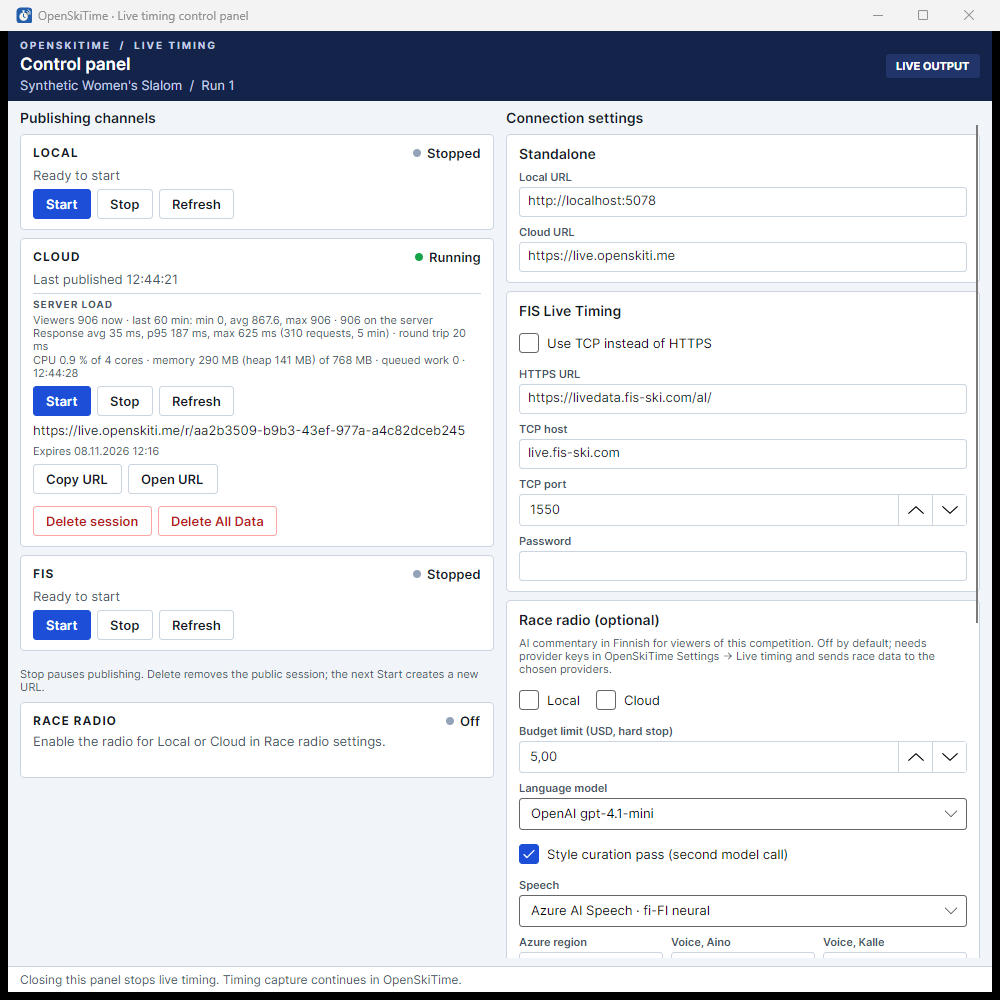

# Live timing viewer load test

How many people can follow one race on the cloud live timing server, measured on the production service
`live.openskiti.me` with the real desktop application publishing. All race data was synthetic.

## Result — 2026-10-25

900 simulated viewers followed a 100-racer synthetic slalom for 30 minutes on the production deployment (Azure
Container Apps, Sweden Central, one replica with 0.5 vCPU and 1 GiB). A few real visitors also opened the race from the
public front page (up to 906 viewers in total). Every viewer received every update. Nothing failed or dropped during the
race. After a forced server restart, all 900 viewers reconnected within 12 seconds and never saw an empty page.

| Measure | Result |
|---|---|
| Viewers connected on their first attempt | 900 / 900; first state p50 8 ms, p95 15 ms, max 327 ms after connecting |
| Updates published (start, intermediate and finish of 100 racers) | 309, each reaching all 900 viewers (278,100 State messages, 14.8 GB) |
| State message size | p50 53 kB, max 66 kB (full snapshot of 100 racers) |
| Fan-out spread: a viewer's receipt after the first viewer of the same update | p50 101 ms, p95 267 ms, p99 346 ms, max 700 ms |
| Desktop publish stamp to viewer receipt | p50 338 ms, p95 529 ms, max 1.18 s (corrected by the publishing computer's measured clock offset of +0.72 s) |
| Same, local rehearsal on one computer (no network, 50 viewers) | p50 270 ms: most of the delay is the desktop's 250 ms live snapshot cycle, not the network |
| Connection failures or drops during the race | 0 |
| Server process (control panel Server load, 5 s samples, race) | CPU avg 1.7 %, max 4.9 % of the 4 visible cores; working set max 296 MB of 768 MB; queued work 0 |
| Azure Monitor (1 min) | CPU max 0.104 cores (21 % of the 0.5 vCPU allocation), working set max 246 MB, network out max 825 MB/min (110 Mbit/s averaged over that minute), 15.0 GB in total |
| Publisher requests (control panel Server load) | p95 150–200 ms during the race: the server answers a publish after handing the update to every viewer connection |
| Forced restart (new replica, RAM state lost) | All 900 connections closed at once; the control panel republished the race to the new replica before viewers returned; next state p50 1.5 s, p95 7.4 s, max 11.9 s (the viewer's jittered 0.5–15 s backoff). One viewer that connected to the draining replica was recovered by the 35 s silence timeout. |

### Interpretation

- **900 viewers fit comfortably on one 0.5 vCPU replica.** CPU and memory stayed well below the allocation. The hard
  limits are configuration: `LiveTiming__MaxConnections` (1,000) and, per client address, `ConnectionsPerClient` (200)
  and `RequestsPerMinute` (3,000).
- **Fan-out time grows with the number of viewers and the snapshot size.** The load generators used 25–54 millicores of
  their 750 and every generator's first viewer received an update within about 1 ms of the first viewer overall, so the
  100–700 ms spread arises at the server and its ingress, where each update means about 48 MB of writes to 900 sockets.
  The spread rose from about 200 ms to about 320–390 ms (p95) as the snapshot grew from 40 kB to 66 kB.
- **Bandwidth is the quantity to watch for larger events.** Each update is sent as a full snapshot to every viewer, so
  outbound traffic is viewers × snapshot size × updates. The peak was 110 Mbit/s averaged over a minute and up to about 140 Mbit/s in
  30-second windows when several racers finished close together. A field of 2,000 competitors (the contract maximum)
  makes each snapshot about 20 times larger.
- **The panel's CPU figure is a share of the processors .NET sees (4), not of the 0.5 vCPU allocation.** Multiply by
  eight for the share of the allocation. Container Apps did not enforce the allocation as a hard limit: the process
  briefly used 0.72 cores while 900 viewers reconnected to the new replica.

### Limits of this test

- One replica, one race session, no race radio. Radio clips add one download per listener per clip.
- Viewers were simulated by a protocol-level client that matches `wwwroot/live.js` (page assets, negotiation, WebSocket,
  Watch, 15 s pings, 35 s silence timeout, 0.5–15 s jittered reconnect). It does not render the page.
- The load came from five Azure Container Instances in Sweden Central, each with its own public address and 180
  viewers, so the production per-address limits applied unchanged. Real viewers on mobile networks have slower and
  less reliable links.
- The publish-to-viewer delay depends on two clocks. The publishing computer was measured against `time.windows.com`
  before and after the run (−0.703 s and −0.728 s) and corrected by 0.715 s.

## Tools

- `src/OpenSkiTime.LiveTiming.LoadTest` — viewer load generator, no package dependencies. It records every received
  State message and every connection, prints a status line every 10 s and writes `report.md`, `states.csv.gz` and
  `attempts.csv.gz`. With `--control <blob container SAS URL>` several generators started ahead of time wait for the
  blob `session.txt`, stop when the blob `stop` appears and upload their results under `results/<label>/`.
  `--whoami https://api.ipify.org` prints each generator's public address.
- `tests/OpenSkiTime.Desktop.E2E/LivePerformanceTests.cs` — the publisher: the real desktop application times the
  synthetic race in real time with the simulator and publishes it to Cloud through the control panel. It logs the
  panel's Server load every 5 s (`server-load.tsv`), saves panel screenshots at each 25 finishers and every 2 minutes
  after the race, and deletes the public session at the end. It takes over mouse and keyboard.

## Procedure

1. Build `src/OpenSkiTime.Desktop` and `tests/OpenSkiTime.Desktop.E2E` (Release) and publish the load generator image to
   a registry the containers can pull from:
   `dotnet publish src/OpenSkiTime.LiveTiming.LoadTest -c Release -t:PublishContainer -p:ContainerRegistry=<registry>`.
2. Save a publisher key for the server in Settings → Live timing. For `live.openskiti.me`, issue a temporary key with
   `deploy/azure/Set-LivePublisherKey.ps1 -Name perf-test` and remove it afterwards with `-Remove perf-test`. Both start
   a new revision, so run them only when no race is published.
3. Create a blob container and a container SAS URL with read, write and list permission. Start the generators, for
   example five Container Instances with 0.75 vCPU and 1.5 GB each:
   `--origin https://live.openskiti.me --control "$CONTROL" --viewers 180 --ramp-seconds 120 --minutes 75 --label loadN --whoami https://api.ipify.org`.
   Pass the SAS URL as a secure environment variable. Container Instances do not guarantee distinct outbound addresses:
   compare the printed addresses and recreate a generator that shares one, because more than 200 viewers behind one
   address are refused.
4. Run the publisher: `OPENSKITIME_DESKTOP_E2E=1`, `OPENSKITIME_LIVE_PERF=<output folder>`,
   `OPENSKITIME_LIVE_PERF_VIEWERS=900`, then
   `dotnet test tests/OpenSkiTime.Desktop.E2E -c Release --no-build --filter FullyQualifiedName~LivePerformanceTests`.
   When `session-url.txt` appears, upload the session ID as the blob `session.txt`. The race starts when the panel
   reports 900 viewers. `OPENSKITIME_LIVE_PERF_CLOUD=http://localhost:5080` and `OPENSKITIME_LIVE_PERF_RACERS=3` give a
   short rehearsal against a local server.
5. Optionally restart the revision after the last finish to measure recovery
   (`az containerapp revision restart`), with no other race on the server.
6. Upload the blob `stop`, wait for the generators' results, then create `<output folder>/stop` so that the publisher
   deletes the session. Delete the generators and the temporary key.

The run cost well under one euro: five Container Instances for about 75 minutes, a Basic container registry and a
storage account for a few hours, all deleted afterwards.

## Files of the 2026-10-25 run

- [live-timing-load-test-2026-10-25.pdf](live-timing-load-test-2026-10-25.pdf) — printable report with charts.
- `data/` — aggregated results: `timeline.csv` (30 s windows), `server-load.csv` (control panel Server load every 5 s,
  UTC), `distributions.csv`, `headline.csv`, `slowest-updates.csv` and `azure-metrics.csv` (Azure Monitor per minute).
  The raw per-message samples (2.4 MB) are not kept in the repository.
- `screenshots/` — the control panel when published, with 900 viewers before the first start, at the last finish and
  after the server restart.
- `scripts/perf-test/analyze-load-run.py <run folder> <clock correction ms>` combines the generators' raw
  `results/<label>/*.csv.gz` and `server-load.tsv` into `summary.json`; `scripts/perf-test/make-load-report.py
  docs/perf-test <report.html>` builds the printable report from `data/`, which Edge or Chrome prints to PDF
  (`msedge --headless --no-pdf-header-footer --print-to-pdf=<file.pdf> <report.html>`).
