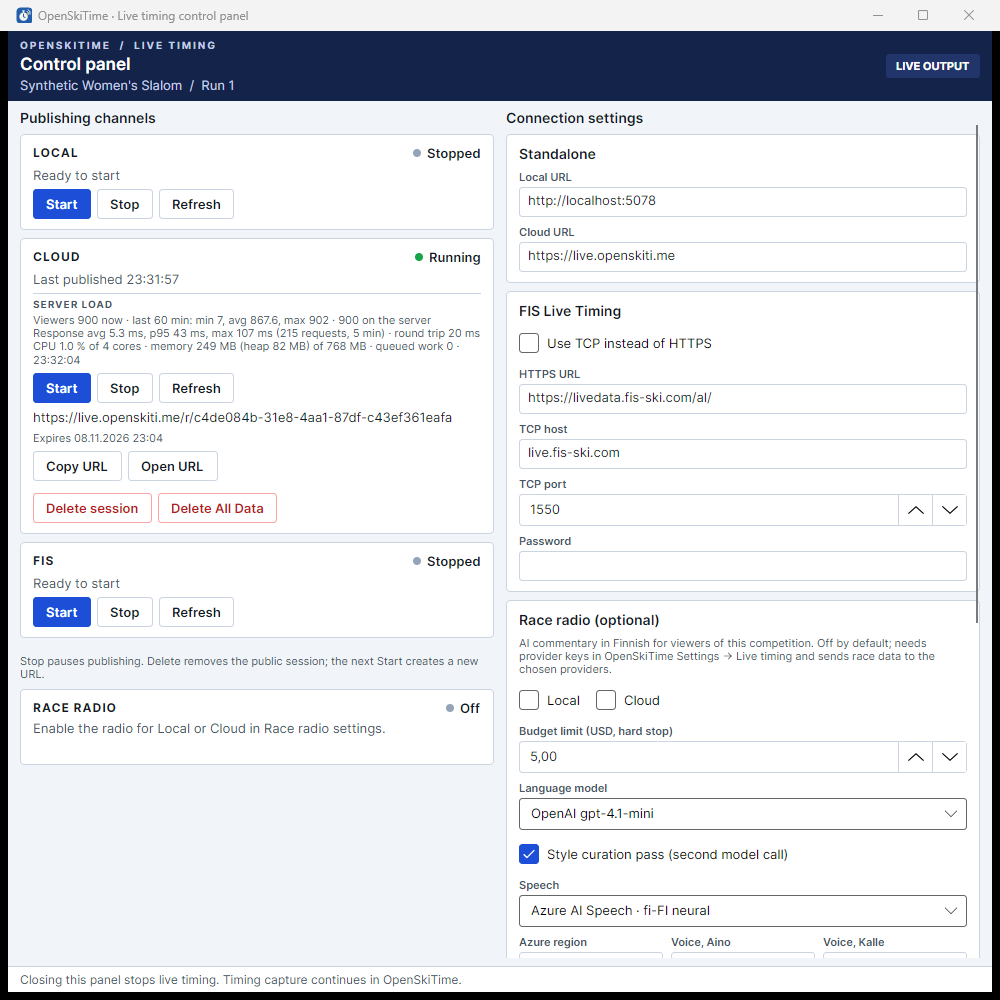

# Live timing viewer load test

How many people can follow one race on the cloud live timing server, measured on the production service
`live.openskiti.me` with the real desktop application publishing, and how much viewer synchronization with
server-computed deltas changes that. All race data was synthetic.

## Viewer synchronization in production — 2026-10-25, live 0.9.0

The cloud test below was repeated the same evening (21:04–21:35 UTC) after live 0.9.0 was deployed: the same production
replica (0.5 vCPU, 1 GiB), the same desktop publisher and 100-racer slalom (a start every 15 s), 900 viewers from five
Azure Container Instances with five different public addresses (now following the race page's delta rules), and a forced
revision restart after the last finish. Data: [`data-0.9/`](data-0.9/) (`compare.csv` puts both runs side by side).

| Measure | live 0.8 (full state per update) | live 0.9 (deltas) |
|---|---:|---:|
| Viewers connected at the first attempt; failures or drops during the race | 900; 0 | 900; 0 |
| Updates published by the desktop | 309 | 310, all sent as deltas |
| Viewers whose final state equals `GET /state`, field for field | – | 900 / 900 |
| Traffic received by all viewers | 14.8 GB | 0.66 GB (deltas 529 MB, full states on (re)subscription 95 MB, radio 33 MB, beacons 5.6 MB) |
| Network out of the server, Azure Monitor | 15.0 GB | 0.75 GB |
| Peak traffic to viewers (30 s window) / network out (minute) | 138 Mbit/s / 825 MB | 15 Mbit/s / 64 MB (the minute 900 viewers connected); about 30 MB a minute while racing |
| Update message size p50 / p95 / max | 53.0 / 64.5 / 65.6 kB | 0.7 / 7.8 / 65.6 kB (the max is the restored state after the restart) |
| Fan-out spread p50 / p95 | 101 / 267 ms | 22 / 64 ms |
| Slowest viewer of an update, p50 / p95 | 238 / 338 ms | 64 / 155 ms |
| Desktop publish to viewer p50 / p95 (clock-corrected, see below) | 338 / 529 ms | 259 / 367 ms |
| Publisher response p95 (control panel Server load, during the race) | up to 202 ms | up to 43 ms |
| Server CPU in the race, peak / average (5 s samples, share of 0.5 vCPU) | 39 % / 13 % | 21 % / 10 % |
| Server working set, max in the race | 296 MB | 251 MB |
| Restart: drop to next state p50 / p95 / max | 1.5 / 7.4 / 11.9 s | 2.0 / 7.7 / 13.1 s (the viewers' jittered 0.5–15 s reconnect) |
| Gaps found / resync requests | – | 0 / 0 |

- **Traffic fell by 95 %**, both as received by the viewers and as measured by Azure. All 310 updates were deltas: in
  this race no finish moved more than half the field. A full state is now sent only once per (re)subscription.
- **Delivery got faster everywhere.** With a few kilobytes per viewer instead of 53 kB, the server finishes each
  fan-out sooner: the spread fell by about three quarters, and the publisher's own requests (which return after the
  fan-out) by the same proportion. The heavier tail seen in the local comparison below came from the load generator
  sharing the server's computer; with remote generators the tail improved too.
- **Recovery is unchanged:** the restart closed all 900 connections; viewers came back within the same jittered backoff,
  got `Awaiting` until the control panel restored the race (one full state of a new generation) and ended equal to the
  server's state.
- **Clock:** the desktop-to-viewer delay depends on the publishing computer's clock. Measured against
  `time.windows.com` at the end of the run it was 1.15 s ahead and then resynchronized (later samples within 1 ms),
  so the delay is corrected by 1.15 s and is indicative only. Fan-out spread does not depend on it.
- Not covered, as before: race radio clips, several races at once, real mobile networks, fields larger than 100.

## Viewer synchronization: local before/after — 2026-10-25

The same synthetic 100-racer slalom (290 updates: starts and intermediates as events, finishes as full states that
re-rank the field) was published in real time to a local server with 900 simulated viewers, once with the server before
viewer synchronization (commit `89b5561`, viewers subscribing as those pages did) and once with deltas, sync beacons and
resync. After the last finish the server process was killed and restarted with the same signing key; the publisher
restored the race. **Run locally, not in the cloud:** server, publisher (`Harness load-race`, start interval 6 s) and load
generator shared one Windows 11 laptop (Intel Core i7-11850H, 16 logical processors, 31 GB) over loopback, with the
per-client limits raised (`MaxConnections`/`ConnectionsPerClient` 3000, `RequestsPerMinute` 100000). Absolute times are
therefore not comparable with the cloud run below; bytes are.

| Measure | Before (full `State` per update) | After (deltas) |
|---|---:|---:|
| Viewers whose final state equals `GET /state`, field for field | 900 / 900 | 900 / 900 |
| Updates reaching all 900 viewers | 290 + restore | 290 + restore |
| Race data received by all viewers | 13,159 MB (263,700 `State`) | 1,128 MB (256,500 `Delta` 770 MB, 7,022 `Sync` 358 MB) |
| All WebSocket messages (incl. radio, viewer count, beacons) | 13,184 MB | 1,156 MB (−91 %) |
| Average / largest update message | 49.9 kB / 61.1 kB | 4.1 kB / 61.1 kB (deltas: average 3.0 kB, largest 29.7 kB) |
| Updates sent as a full state | 290 | 5 (late finishes that re-ranked most of the field: delta over half the state) |
| Sync beacons | – | 24,300 messages, 2.6 MB |
| Peak outbound rate, 10 s / 30 s / 60 s windows | 287 / 218 / 202 Mbit/s | 48 / 31 / 22 Mbit/s |
| Fan-out spread (receipt after the first viewer of the same update), p50 / p95 / p99 / max | 26 / 49 / 63 / 128 ms | 11 / 63 / 113 / 196 ms |
| Publish stamp to viewer receipt, p50 / p95 / p99 | 29 / 52 / 66 ms | 14 / 66 / 116 ms |
| Server CPU (5 s samples during the race, of 16 processors), average / max | 0.7 % / 4.5 % | 0.5 % / 3.3 % |
| Server working set / managed heap, max | 252 MB / 147 MB | 198 MB / 104 MB |
| Server thread-pool queue, max | 275 | 0 |
| Publisher response p95 (server load report), max | 28 ms | 15 ms |
| Forced restart: drop to subscription reply, p50 / p95 / max | 757 / 990 / 1015 ms | 750 / 1159 / 1187 ms |
| Forced restart: drop to race data again, p50 / p95 / max | 1331 / 1349 / 1364 ms | 1014 / 1159 / 1187 ms |
| Gaps found / resync requests | – | 0 / 0 |

- **Bandwidth fell by about 91 %** and the peak rate by about 85 %; server memory and CPU fell too. Most finishes are
  deltas of the rows whose rank or difference moved (a few kB); only finishes late in the race that re-rank most of the
  field exceed half the state and go out as the full state.
- **The median fan-out halved, but its tail grew** (p95 63 ms, p99 113 ms against 49 ms and 63 ms). The tail grows with
  the delta size (p99 91 ms for deltas under 2 kB, 154 ms above 10 kB). The cause is not isolated: in this local run the
  load generator kept and merged a JSON tree per viewer on the same processors as the server, which a browser does once
  per page; the server's thread-pool queue stayed at 0. With remote generators in the production run above, the tail
  fell too (p95 267 → 64 ms), so the local tail reflects the shared computer rather than the server.
- No viewer lost a message on these healthy loopback connections, so gap detection and resync were exercised by the
  automated tests (C# process tests, Node tests of `live-sync.js`, Chromium end-to-end), not by this run.

## Result — 2026-10-25 (before viewer synchronization)

900 simulated viewers followed a 100-racer synthetic slalom for 30 minutes on the production deployment (Azure
Container Apps, Sweden Central, one replica with 0.5 vCPU and 1 GiB). A few real visitors also opened the race from the
public front page (up to 906 viewers in total). Every viewer received every update. Nothing failed or dropped during the
race. After a forced server restart, all 900 viewers reconnected within 12 seconds and never saw an empty page.

| Measure | Result |
|---|---|
| Viewers connected on their first attempt | 900 / 900; first state p50 8 ms, p95 15 ms, max 327 ms after connecting |
| Updates published (start, intermediate and finish of 100 racers) | 309, each reaching all 900 viewers (278,100 State messages, 14.8 GB) |
| State message size | p50 53 kB, max 66 kB (full snapshot of 100 racers) |
| Fan-out spread: a viewer's receipt after the first viewer of the same update | p50 101 ms, p95 267 ms, p99 346 ms, max 700 ms |
| Desktop publish stamp to viewer receipt | p50 338 ms, p95 529 ms, max 1.18 s (corrected by the publishing computer's measured clock offset of +0.72 s) |
| Same, local rehearsal on one computer (no network, 50 viewers) | p50 270 ms: most of the delay is the desktop's 250 ms live snapshot cycle, not the network |
| Connection failures or drops during the race | 0 |
| Server process (control panel Server load, 5 s samples, race) | CPU avg 1.7 %, max 4.9 % of the 4 visible cores; working set max 296 MB of 768 MB; queued work 0 |
| Azure Monitor (1 min) | CPU max 0.104 cores (21 % of the 0.5 vCPU allocation), working set max 246 MB, network out max 825 MB/min (110 Mbit/s averaged over that minute), 15.0 GB in total |
| Publisher requests (control panel Server load) | p95 150–200 ms during the race: the server answers a publish after handing the update to every viewer connection |
| Forced restart (new replica, RAM state lost) | All 900 connections closed at once; the control panel republished the race to the new replica before viewers returned; next state p50 1.5 s, p95 7.4 s, max 11.9 s (the viewer's jittered 0.5–15 s backoff). One viewer that connected to the draining replica was recovered by the 35 s silence timeout. |

### Interpretation

- **900 viewers fit comfortably on one 0.5 vCPU replica.** CPU and memory stayed well below the allocation. The hard
  limits are configuration: `LiveTiming__MaxConnections` (1,000) and, per client address, `ConnectionsPerClient` (200)
  and `RequestsPerMinute` (3,000).
- **Fan-out time grows with the number of viewers and the snapshot size.** The load generators used 25–54 millicores of
  their 750 and every generator's first viewer received an update within about 1 ms of the first viewer overall, so the
  100–700 ms spread arises at the server and its ingress, where each update means about 48 MB of writes to 900 sockets.
  The spread rose from about 200 ms to about 320–390 ms (p95) as the snapshot grew from 40 kB to 66 kB.
- **Bandwidth is the quantity to watch for larger events.** Each update is sent as a full snapshot to every viewer, so
  outbound traffic is viewers × snapshot size × updates. The peak was 110 Mbit/s averaged over a minute and up to about 140 Mbit/s in
  30-second windows when several racers finished close together. A field of 2,000 competitors (the contract maximum)
  makes each snapshot about 20 times larger.
- **The panel's CPU figure is a share of the processors .NET sees (4), not of the 0.5 vCPU allocation.** Multiply by
  eight for the share of the allocation. Container Apps did not enforce the allocation as a hard limit: the process
  briefly used 0.72 cores while 900 viewers reconnected to the new replica.

### Limits of this test

- One replica, one race session, no race radio. Radio clips add one download per listener per clip.
- Viewers were simulated by a protocol-level client that matches `wwwroot/live.js` (page assets, negotiation, WebSocket,
  Watch, 15 s pings, 35 s silence timeout, 0.5–15 s jittered reconnect). It does not render the page.
- The load came from five Azure Container Instances in Sweden Central, each with its own public address and 180
  viewers, so the production per-address limits applied unchanged. Real viewers on mobile networks have slower and
  less reliable links.
- The publish-to-viewer delay depends on two clocks. The publishing computer was measured against `time.windows.com`
  before and after the run (−0.703 s and −0.728 s) and corrected by 0.715 s.

## Tools

- `src/OpenSkiTime.LiveTiming.LoadTest` — viewer load generator, no package dependencies. Each simulated viewer
  subscribes like the race page (`WatchSync`) and applies deltas, beacons and resyncs with the page's rules
  (`live-sync.js`); `--legacy` subscribes like a page opened before viewer synchronization (`Watch`, a complete `State`
  after every change). It records every received hub message with its kind and size and every connection, prints a
  status line every 10 s, and at the end compares every viewer's final state with `GET /api/sessions/{id}/state` field
  for field (source ticks included); a difference makes the run fail (exit code 1). Stop it only after the last
  publish. It writes `report.md`, `states.csv.gz` (one line per message, with its `kind`) and `attempts.csv.gz`. With
  `--control <blob container SAS URL>` several generators started ahead of time wait for the blob `session.txt`, stop
  when the blob `stop` appears and upload their results under `results/<label>/`. `--whoami https://api.ipify.org`
  prints each generator's public address.
- `OpenSkiTime.LiveTiming.Harness load-race <origin> [racers] [start interval s] [output folder]` — a synthetic
  publisher without the desktop: a one-run slalom in real time (one intermediate, finishes after 45–60 s, every 17th
  bib DNS and every 13th DNF; the first start 30 s after publishing begins), published through the same
  `StandalonePublisher` as the worker (a start or intermediate as an event, a finish that moves other ranks as a full
  state). It logs the server's load report every 5 s (`server-load.tsv`) and republishes the race when the server lost
  it. The publisher key comes from `OST_LIVE_PUBLISHER_KEY`.
- `tests/OpenSkiTime.Desktop.E2E/LivePerformanceTests.cs` — the publisher: the real desktop application times the
  synthetic race in real time with the simulator and publishes it to Cloud through the control panel. It logs the
  panel's Server load every 5 s (`server-load.tsv`), saves panel screenshots at each 25 finishers and every 2 minutes
  after the race, and deletes the public session at the end. It takes over mouse and keyboard.

## Procedure

1. Build `src/OpenSkiTime.Desktop` and `tests/OpenSkiTime.Desktop.E2E` (Release) and publish the load generator image to
   a registry the containers can pull from:
   `dotnet publish src/OpenSkiTime.LiveTiming.LoadTest -c Release -t:PublishContainer -p:ContainerRegistry=<registry>`.
2. Save a publisher key for the server in Settings → Live timing. For `live.openskiti.me`, issue a temporary key with
   `deploy/azure/Set-LivePublisherKey.ps1 -Name perf-test` and remove it afterwards with `-Remove perf-test`. Both start
   a new revision, so run them only when no race is published.
3. Create a blob container and a container SAS URL with read, write and list permission. Start the generators, for
   example five Container Instances with 0.75 vCPU and 1.5 GB each:
   `--origin https://live.openskiti.me --control "$CONTROL" --viewers 180 --ramp-seconds 120 --minutes 75 --label loadN --whoami https://api.ipify.org`.
   Pass the SAS URL as a secure environment variable. Container Instances do not guarantee distinct outbound addresses:
   compare the printed addresses and recreate a generator that shares one, because more than 200 viewers behind one
   address are refused.
4. Run the publisher: `OPENSKITIME_DESKTOP_E2E=1`, `OPENSKITIME_LIVE_PERF=<output folder>`,
   `OPENSKITIME_LIVE_PERF_VIEWERS=900`, then
   `dotnet test tests/OpenSkiTime.Desktop.E2E -c Release --no-build --filter FullyQualifiedName~LivePerformanceTests`.
   When `session-url.txt` appears, upload the session ID as the blob `session.txt`. The race starts when the panel
   reports 900 viewers. `OPENSKITIME_LIVE_PERF_CLOUD=http://localhost:5080` and `OPENSKITIME_LIVE_PERF_RACERS=3` give a
   short rehearsal against a local server.
5. Optionally restart the revision after the last finish to measure recovery
   (`az containerapp revision restart`), with no other race on the server.
6. Upload the blob `stop`, wait for the generators' results, then create `<output folder>/stop` so that the publisher
   deletes the session. Delete the generators and the temporary key.

Local before/after comparison (no cloud resources): build the server of each version (Release; the earlier one in a
separate `git worktree`), the harness and the load generator. Start one server with a signing key, a publisher key hash
and raised limits (`LiveTiming__MaxConnections=3000`, `LiveTiming__ConnectionsPerClient=3000`,
`LiveTiming__RequestsPerMinute=100000`), then `OpenSkiTime.LiveTiming.Harness load-race http://127.0.0.1:<port> 100 6
<folder>` with `OST_LIVE_PUBLISHER_KEY` set, and the load generator with `--session <ID from session.txt> --viewers 900
--ramp-seconds 20 --minutes 14` (plus `--legacy` against a server before viewer synchronization). To measure recovery,
kill and restart the server process after the last finish with the same environment. Stop the publisher after the
load generator has finished, so that its final comparison sees the last state.

The cloud run cost well under one euro: five Container Instances for about 75 minutes, a Basic container registry and a
storage account for a few hours, all deleted afterwards.

## Files of the 2026-10-25 runs

- [live-timing-load-test-2026-10-25.pdf](live-timing-load-test-2026-10-25.pdf) — printable report with charts.
- `data/` — aggregated results: `timeline.csv` (30 s windows), `server-load.csv` (control panel Server load every 5 s,
  UTC), `distributions.csv`, `headline.csv`, `slowest-updates.csv` and `azure-metrics.csv` (Azure Monitor per minute).
  The raw per-message samples (2.4 MB) are not kept in the repository.
- `screenshots/` — the control panel when published, with 900 viewers before the first start, at the last finish and
  after the server restart.
- `data-0.9/` and `screenshots-0.9/` — the same for the live 0.9.0 run, plus `compare.csv` (both runs side by side) and
  `messages-by-kind.csv` (messages and megabytes per SignalR target). `distributions.csv` adds the time from a restart
  drop to results again.
- `scripts/perf-test/analyze-load-run.py <run folder> <clock correction ms>` combines the generators' raw
  `results/<label>/*.csv.gz` and `server-load.tsv` into `summary.json`; `scripts/perf-test/make-load-report.py
  docs/perf-test <report.html>` builds the printable report from `data/`, which Edge or Chrome prints to PDF
  (`msedge --headless --no-pdf-header-footer --print-to-pdf=<file.pdf> <report.html>`).
