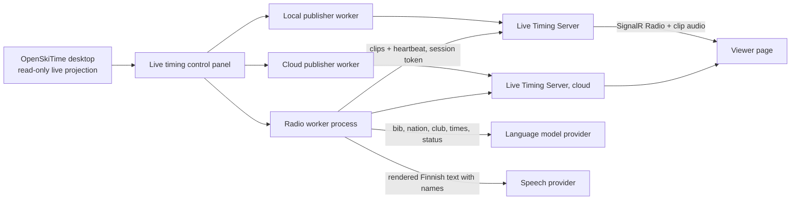

# Race radio

The race radio is an optional, AI-generated Finnish commentary for viewers of OpenSkiTime Standalone live timing (Local and Cloud). Two fictional hosts, Aino (commentator) and Kalle (expert), talk about finishes, new leaders, DNF/DSQ, run ends and, in quiet moments, the standings or the next starter. Viewers press **▶ Radio** on the race page; nothing plays until they do.

The radio is non-authoritative and cloud-dependent. It never touches timing capture, the series database, devices or the FIS channel, and it is off unless the operator enables it per competition. Results it speaks are described as unofficial.

Status: implemented and tested with fake providers and the offline simulation providers. Real provider calls, Finnish voice quality and end-to-end latency need the human listening test and race rehearsal listed under [Unverified](#unverified-items-and-risks).

## Architecture



- **Process isolation.** `OpenSkiTime.LiveTiming.RadioWorker` is a separate process owned by the control panel exactly like the publisher workers: a private, unpredictable, current-user named pipe carries typed JSON commands and status; keys and session tokens travel only through that pipe; on Windows the worker belongs to the panel's kill-on-close Job Object. It receives the same read-only live snapshot the publishers receive and has no series-database or device access. Domain, Timing and Persistence have no radio dependency.
- **No influence on capture or publishing.** The panel offers snapshots by reference; the worker detects events on its own loop. Every provider call has a timeout (dialogue 20 s, curation 15 s, producer 12 s, speech 15 s per line, upload 10 s) and cancellation; queues are bounded (batch of at most six events, sixteen IPC commands, a 32-clip ring on the server). A failing, slow or killed radio worker leaves the publishers, the Local server and the offline Local page untouched; a test kills the worker mid-race and checks that publishing continues.
- **Delivery.** Clips go through the existing Live Timing Server, never a separate stream. The worker uploads each clip to every enabled channel's session with that session's publisher token. While no server accepts clips (every target rejected the radio), nothing is generated or paid for. The server keeps clips only in RAM, announces valid ones over SignalR and serves the audio from its own origin (no CDN).
- **Library layout.** `OpenSkiTime.LiveTiming.Radio` contains the deterministic rules (verbalizer, slots, detector, batcher, producer gate, memories, budget, templates, prompts), the engine and the provider adapters. Shared contracts (clip upload, announcement, phase model, stale-clip rules) are in `OpenSkiTime.LiveTiming.Contracts`, so the worker and the server apply the same rules.

### Pipeline

1. **Detection** (deterministic, from consecutive snapshots of the current run; events of a run that is no longer current are dropped): first start of a run, every start (a top-three racer starting a later run as a top start), finish (new leader, podium place or other), DNF, DSQ, DNS, result correction, run complete, and an interruption (a run in progress with nobody on course and no update for four minutes). The first snapshot is history and is not announced. A run lasts 45-80 s with one or two racers on course, so each start names the racer who left and the next racer in the start gate (the first still waiting in the start order); the clip is stale once that racer leaves the course or the next racer is no longer next.
2. **Priority batcher.** Events of another run or of a phase that no longer applies are dropped, so a batch never mixes incompatible phases. Delays by the highest priority in the batch: 2 s (P1), 5 s (P2: new leader, podium, run complete, start, top start), 12 s (P3: finish, DNF/DSQ, correction, run start), 25 s (P4: DNS), 40 s (P5: producer). A higher priority shortens the delay from its arrival; six events flush at once. Events that went stale while waiting are dropped.
3. **Dialogue** by the language model (JSON lines `{host, text, interruptible}`), or by templates (see 6).
4. **Validation** of every line before speech (see [Finnish verbalization](#finnish-verbalization-and-guardrails)). Common alternative case codes (`part`, `lle`, `ssa` …) are first mapped to the listed ones, and inflected forms of allowed names (Harjoitusrinteellä) pass. A script with invalid lines gets one **repair** call: the model receives its script, each rejected line, the reason and the offending word (never a racer name) and returns it fixed. If the repaired script still has an invalid line, templates are used. In a synthetic test with `gpt-4.1-mini` (2026-10-23) about a third of first scripts had an invalid line, mostly number words for places and counts.
5. **Curation** (optional second model pass): style only; the line count, hosts and every slot must stay identical and each line must still validate, otherwise the original script is used. Detected style patterns feed the style memory.
6. **Templates.** Deterministic Finnish phrases for every core event when the model fails, times out, returns invalid output, or the budget allows speech only.
7. **Rendering** of slots to Finnish, then **speech** per line with the host's voice.
8. **Stale check before upload.** If the latest snapshot contradicts the batch (a racer is no longer on course, a stated leader was beaten, a time was corrected, the run changed) or the batch expired, the rest of the batch is dropped. A low-priority conversation stops at its next interruptible line when urgent news is waiting.
9. **Server.** The ring keeps at most 32 clips and 8 MiB per session, and `LiveTiming__RadioMaxMegabytes` (default 64) across sessions. On every state change, upload and heartbeat, and every two seconds, the server sends a `Radio` announcement with only the clips that are still playable: before expiry, in an applicable race phase and with every stated fact still true.
10. **Viewer.** Plays announced clips one at a time (0.35 s between lines of a conversation, 1.2 s between conversations); the most urgent conversation goes next, but a conversation is not cut mid-sentence pair. Starting or resuming joins at the live edge: clips older than 15 s are skipped, measured with the server's clock (each announcement carries the server time and each clip its receive time), so a page opened later does not replay the backlog and a browser clock that is off does not expire fresh clips. After a line that does not end a sentence pair the viewer waits up to 40 s for the next one (speech 15 s plus an upload to each of two servers, 10 s each); it gives the conversation up at once when the server withdraws the line it just played, because the worker drops a stale batch by the same rules.

### Race phase model

The phase is derived from the snapshot of the current run: **BeforeStart** (run 1 not started), **RunInProgress**, **Interrupted** (started, nobody on course, no update for four minutes), **BetweenRuns** (a run complete with another planned, or the next run not started) and **AfterRace** (the last planned run complete). DH and SG have one planned run, other disciplines two, because the snapshot does not carry a planned run count. Inactivity uses the snapshot update time stamped by the publisher, never device timestamps, which may be set to another time of day. The phase gates producer sources and clip applicability (a run summary clip is dropped once the next run starts).

### Producer (idle moments)

When nothing is waiting and the last speech ended long enough ago, the producer picks at most one source: **standings** (unofficial top three), **next_starter**, **on_course**, **run_summary**, **event_context** (operator background) or **general**. A hard code gate checks the phase allowlist and that a named racer is a participant in the right state (waiting to start, on course); a rejected choice is retried once with the failed source named, then the code picks a valid source deterministically. The minimum interval is budget-aware: 60 s at the start, rising to 240 s as the budget is used. The producer stops 30 minutes after the race ends.

### Memories (RAM only)

- **Topic memory:** model summaries (at most ten words) for two hours, at most 50, so hosts avoid repeating themselves.
- **Style memory:** the last 30 jokes, analogies and phrases reported by curation.
- **Event diary:** at most 40 key moments; when full, the least relevant is evicted only for a more relevant one. Relevance is deterministic by event kind (run complete 9, new leader 8, interruption 7, podium 5, DNF/DSQ 4, finish 2), which saves the extra model call mikradio uses.

None of these, nor any transcript, is written to disk.

## Reference implementation: mikradio

[mikradio](https://github.com/lassiniemisto/mikradio) (Python, AI motorsport radio for endurance karting, reviewed at commit `7c0ed0e`, 2026-09-04) was studied with its author's permission to use its ideas and code. Its `speech/`, `radio/api/` and `team-tracker/` modules map onto OpenSkiTime as follows. Everything was reimplemented in C#; no Python services or Docker are used. Prompt structure and rules are adapted in `RadioPrompts`; see [THIRD-PARTY-NOTICES.md](../THIRD-PARTY-NOTICES.md). No voice IDs, `teams.json`, seed articles or real names were copied.

| mikradio | OpenSkiTime | Decision and reason |
|---|---|---|
| `team-tracker` analyzers (best lap, position jump, stale team, back to track) on snapshot diffs | `RadioEventDetector` on live snapshot diffs | **Adapted.** Same deterministic approach, alpine events instead of lap events. |
| `speech/event_batcher.py`: priority-dependent delays, early flush on higher priority, max batch | `EventBatcher` | **Adopted** with shorter alpine delays (finishes every 40-60 s) and explicit time. Stale events are pruned before generation. |
| `speech/dialogue.py`: JSON lines `{host_id, text, interruptible}`, adaptive verbosity, factual discipline | `RadioPrompts.DialogueSystem`, `RadioEngine` | **Adapted.** Kept the structure and the verbosity and factual-discipline rules; replaced "pre-convert numbers to text" by slots; hosts never see names. |
| `speech/dialogue_curation.py`: style-only second pass, same line count/hosts/facts, fallback to original | `CurateAsync` | **Adopted**, and strengthened: slots must be identical and each curated line must pass validation. Curation no longer fixes number inflection (code does). |
| `speech/tts.py`, `personalities/hosts.yaml`: per-host, per-provider voice configuration | `RadioPersonas`, provider adapters | **Adopted** in code, with operator-overridable voice names. |
| `radio/api/queue_manager.py`: priority, expiry (`rot_time`), phase applicability, dropping late clips of cancelled batches, pauses between lines/batches | Engine stale check and batch cut, server ring and playable filter, viewer playback | **Adapted.** Liquidsoap queues become a RAM ring plus viewer playback; silence clips become viewer pauses. Added invalidation by contradicting facts. |
| `speech/producer.py` + `filler.py`: producer for idle moments, at most one source from an allowlist, hard phase gate, one retry | `ProducerGate`, `ProduceAsync` | **Adopted** with alpine sources, a participant check and a deterministic fallback. Triggered by an idle clip queue instead of a music track ending. |
| `topic_memory.py` (TTL), `style_memory.py` (fed by curation), `event_diary.py` (relevance eviction) | `TopicMemory`, `StyleMemory`, `EventDiary` | **Adopted** in RAM only; diary relevance is deterministic. |
| `context_files.py`: series/event description, curation rules | Panel fields *Event background* and *Curation notes* per competition | **Adopted.** |
| LLM writes numbers as words; curation fixes inflection | Slots and `FinnishNumbers`/`FinnishVerbalizer` | **Replaced.** Code renders every number, time, gap, place, bib, status and name. |
| Liquidsoap mixer + Icecast stream, music and ambient beds | Clips through the Live Timing Server; optional music played by the viewer | **Rejected as default** (see [delivery](#delivery-clips-versus-a-continuous-stream)). mikradio ships no music (`radio/music/` is empty; operators add MP3 files). OpenSkiTime keeps that model: the operator chooses a folder, and the viewer plays the tracks and dips them under speech instead of a server-side mixer. See [background music](#background-music). |
| Speedhive HTML scraping, WhatsApp listener, LLM parsing of free-text schedules | Typed live snapshot | **Rejected.** OpenSkiTime has authoritative typed data. |
| Environment-variable configuration, plaintext `.env` keys | Panel settings per competition; keys in Windows Credential Manager | **Rejected.** |
| Unbounded fire-and-forget tasks (`asyncio.create_task`) | One engine loop and one heartbeat loop with timeouts and cancellation | **Rejected.** |
| Debug logging of prompts, payloads and transcripts | Logs carry lifecycle, counts and OpenSkiTime's own messages | **Rejected.** |
| Edgy persona instructions (sarcasm, roasting, "mildly sexist" jokes) | Respectful personas | **Rejected.** Alpine fields often include juniors. |

### The Wapice approach

Wapice's [AI radio hosts for live event commentary](https://wapice.com/insights/ai-radio-hosts-live-event-commentary/) (accessed 2026-10-23) describes the same pipeline as mikradio: producer agent, multi-host dialogue, curation against a style memory, per-host TTS, Liquidsoap mixer and an audio stream, with an event diary, team context, topic memory and a phase model. It reports under 100 € for an eight-hour broadcast day, found Gemini voices the best price-to-quality and ElevenLabs the best but too expensive for continuous broadcast, and lists the problems this design addresses: Finnish numbers ("the worst offender"), style instructions read aloud, models rewriting words or "correcting" phonetic proper nouns, voice drift between clips, and repeated phrases.

OpenSkiTime keeps the producer/dialogue/curation/memory structure but has typed data, frequent short events and viewers who already watch the results page, so it speaks only when there is something to say, sends clips instead of a continuous stream, and renders every fact in code.

## Research: providers, delivery, latency and cost

All prices are USD list prices, accessed **2026-10-23** (the date of the price table in `RadioPrices`). Free tiers are ignored in the budget, so it is conservative. Prices change; update `RadioPrices` and this section together.

### Speech (TTS)

| Provider and model | Price | Finnish | Notes |
|---|---|---|---|
| **Azure AI Speech**, neural (`fi-FI-SelmaNeural`, `NooraNeural`, `HarriNeural`) | $15 / 1M characters (S1, West Europe retail price, effective 2024-02-01); 0.5M characters free per month | Three fi-FI voices, no styles | Classic neural voice: reads the input verbatim. SSML prosody rate. MP3 output (24 kHz, 48 kbit/s). **Default.** |
| **Google Cloud TTS, Chirp 3: HD** (`fi-FI-Chirp3-HD-*`) | $30 / 1M characters; first 1M free per month | fi-FI available | Verbatim reading; speaking rate 0.25-2.0; custom pronunciations are **not** available for fi-FI. API-key authentication in the adapter is unverified. |
| **Gemini TTS** (`gemini-3.8-flash-tts`; also 3.1 Flash preview, 2.5 Flash/Pro preview) | 3.8 Flash: $0.50 / 1M text tokens and $9 / 1M audio tokens (25 tokens per second) until 2026-12-31, then $1 and $18 | Finnish listed for 3.8 Flash, not for 3.8 Flash-Lite | Language-model voice with style prompts and two-speaker requests; best price-to-quality in Wapice's tests. **Not implemented:** the current REST shape (`interactions` endpoint, `speech_metadata.style`) is new, output is 24 kHz PCM/WAV (about eight times larger than 48 kbit/s MP3 without an encoder), prices double on 2027-01-01, and the Gemini API terms do not allow apps likely to be used by people under 18, which alpine junior events are. |
| **ElevenLabs** Flash/Turbo, Multilingual v2, v3 | Flash/Turbo $40 / 1M characters; Multilingual v2 and v3 $80 / 1M | Finnish in the multilingual models; Flash language list not published on the pricing page | Highest quality in Wapice's tests, most expensive. Not implemented. |
| **OpenAI** `gpt-4o-mini-tts` | $0.60 / 1M text tokens, $12 / 1M audio tokens (≈ $0.015 per minute); `tts-1` $15 / 1M characters | Multilingual | Language-model voice with instructions; may alter words. Implemented as an alternative; word fidelity needs the listening test. |

LLM-based speech (Gemini TTS, `gpt-4o-mini-tts`) takes style prompts and may change words, read stage directions aloud or "correct" names. Classic neural speech (Azure, Chirp 3: HD) reads exactly what it receives, which matters because OpenSkiTime has already rendered numbers and names in code. The choice must not lower Finnish quality: Azure is the default because it is verbatim, cheapest per character, has three native Finnish voices and needs no audio re-encoding. Gemini or ElevenLabs may sound livelier; switching to them is a listening-test decision, not a cost one.

### Language model

| Provider and model | Input / output per 1M tokens | Notes |
|---|---|---|
| OpenAI `gpt-4.1-mini` | $0.40 / $1.60 | **Default.** Non-reasoning, low latency, JSON mode. |
| OpenAI `gpt-4.1-nano` | $0.10 / $0.40 | Cheapest OpenAI option in the table; weaker Finnish style. |
| OpenAI `gpt-4o-mini` | $0.15 / $0.60 | mikradio's default. |
| Google `gemini-2.5-flash` | $0.30 / $2.50 | Thinking disabled (`thinkingBudget: 0`) for latency; thinking tokens would bill as output. |
| Google `gemini-2.5-flash-lite` | $0.10 / $0.40 | Cheapest. |

Reasoning models (for example `gpt-5-mini`) were left out: they add latency and hidden output tokens for a task that is short, structured and validated by code. Anthropic models were not evaluated in this round.

**Is curation worth it?** It roughly doubles model tokens per batch (about $0.07 per race hour with `gpt-4.1-mini`) and adds 1.5-3 s of latency. Because code now renders numbers and names, curation only improves style and variety; it can be switched off per competition. It is skipped automatically when less than 20 % of the budget remains.

### Delivery: clips versus a continuous stream

| | Clips through the Live Timing Server (chosen) | Liquidsoap + Icecast stream |
|---|---|---|
| Components | None new; the existing server and page | Two more containers or processes per server |
| Scale to zero | Unchanged: the server is active only while publishing | The stream container must run for the whole broadcast |
| Hosting | No extra compute | ≈ $0.10 per hour for 0.5 vCPU and 1 GiB on Azure Container Apps (Sweden Central: $0.000024 per vCPU-second, $0.000003 per GiB-second, after the monthly free grant) |
| Egress per listener | Speech only: ≈ 7 MB per race hour (48 kbit/s MP3) | Continuous 64-128 kbit/s: 29-58 MB per hour |
| Egress price | First 100 GB per month free, then $0.08/GB (Azure, Internet routing) | Same, ≈ 8× the volume |
| Listener experience | Starts on the race page beside the results, silence between items | Music beds and a radio feel; music needs licensing |
| Local/offline | Works on the Local server like the results | Needs the stream stack on the operator laptop |

### Modelled cost per race hour

Model: an alpine run with a start every 40-60 s (about 75 finishes per hour), two runs, batches mostly of one event, two lines and about 220 rendered characters per batch (times are long when spoken). Prompt sizes are similar to mikradio's: about 2,000 input and 150 output tokens per dialogue call and 1,300 input and 150 output tokens per curation call. Between runs the producer adds about 20 short segments per hour.

| Item | Per race hour |
|---|---|
| Dialogue + curation, `gpt-4.1-mini` (75 × 3,300 in / 300 out) | $0.14 |
| Same with `gemini-2.5-flash` | $0.13 |
| Same with `gpt-4.1-nano` or `gemini-2.5-flash-lite` | $0.03 |
| Speech, 16,500 characters, Azure neural | $0.25 |
| Speech, Google Chirp 3: HD | $0.50 |
| Speech, OpenAI `gpt-4o-mini-tts` (≈ 1,200 s audio) | $0.30 |
| Speech, Gemini 3.8 Flash TTS (until 2026-12-31) | $0.27 |
| Speech, ElevenLabs Flash / Multilingual | $0.66 / $1.32 |
| **Default total (Azure + `gpt-4.1-mini` + curation)** | **≈ $0.40** |

Announcing every start adds up to about 75 short batches per hour (two lines, about 90 rendered characters: the racer who started and the next one in the start gate). Not batched with a finish, they add about $0.14 language model and $0.11 Azure speech, so about $0.65 per hour with the defaults. A two-run race day with a break is about four hours, so roughly $2-2.60 with the defaults. The panel's default budget is $5 per competition.

### Latency (event → audible clip), estimated

| Stage | Time |
|---|---|
| Desktop poll and IPC to the worker | 0.3-0.5 s |
| Batch delay | 5 s (new leader, podium, run complete), 12 s (finish, DNF/DSQ) |
| Dialogue call (short JSON from a mini model) | 1.5-4 s |
| Curation | 1.5-3 s (optional) |
| Speech, first line | 0.5-1.5 s (Azure) |
| Upload, SignalR, viewer pause | 0.5-1.5 s |
| **Total** | **≈ 9-15 s for a new leader, 16-22 s for an ordinary finish; 6-9 s with templates only** |

These are estimates from the configured delays and typical provider latencies, not measurements.

## Finnish verbalization and guardrails

The model receives a fact sheet with bib, nation, club, status, times, ranks and gaps of the racers concerned and the current top three, never names, and the slots it may use for each racer. It must refer to every fact through a slot:

| Slot | Renders | Cases |
|---|---|---|
| `{racer:12}` | Full name as published ("Aada Lumivaara"); only an all-capital surname is title-cased. A foreign racer's name is respelled for a Finnish voice by nation (see below), and the operator lexicon may replace the spoken form | Nominative only: code never inflects names |
| `{club:12}` | The club exactly as published ("Rinneseura") | Nominative |
| `{nation:12}` | Nationality as an adjective ("ruotsalainen") | Nominative |
| `{bib:12:ade}` | "kahdellatoista" | Cardinal: `nom gen par ine ela ill ade abl all ess tra` |
| `{rank:12:ess}`, `{totalrank:…}`, `{prevrank:…}` | "kolmantena"; `card` gives "kolme" | Ordinal cases or `card` |
| `{time:12}`, `{total:12}`, `{prevtime:12}` | "yksi minuutti viisi pilkku nolla kolme", "neljäkymmentäseitsemän pilkku yhdeksänkymmentä sekuntia" | Nominative |
| `{diff:12}`, `{totaldiff:12}` | "nolla pilkku kolmekymmentäneljä sekuntia" | Nominative |
| `{status:12}`, `{status:12:noun}` | DNF "keskeytti" / "keskeytys", DSQ "hylättiin" / "hylkäys", DNS "ei lähtenyt matkaan" | `verb`, `noun` |
| `{num:finished}`, `{ord:run:nom}` | Counts from the fact sheet (`run`, `runs`, `starters`, `finished`, `oncourse`, `remaining`, `dnf`, `dsq`, `dns`) | Cardinal / ordinal cases |

Racers are introduced with their club when they start ("Matkaan lähti Veeti Hankiranta, Rinneseura."). In an international field (more than one nation) a racer from another nation than the field's most common one also gets the nationality ("Lähtöportilla seuraavana ruotsalainen Saga Porttila."). The model is told to do the same, once per racer and run.

**Foreign names.** Finnish voices read Finnish spelling, so `FinnishPronunciation` respells each name word of a non-Finnish racer with ordered rules for the racer's nation: German-speaking (Schneider → Šnaider, Volker → Folker, von → fon), Swedish, Norwegian and Danish (Sjöberg → Šöberj, Göran → Jöran, Kerstin → Šerstin, Snøheim → Snöhäim), Italian (Giacomo → Džakomo), Spanish (Jiménez → Himenes), French, Czech and Slovak, Polish (Szczepański → Štšepanjski), South Slavic and Baltic spellings. English and other nations without regular spelling stay as written. It runs on this computer, so names still go only to the speech provider. The operator lexicon (whole name or one word) always wins. The rules are a heuristic: they are not verified by listening for every voice.

Times and gaps are the display hundredths timing already calculated (`Hundredths`, `Difference`, `TotalHundredths`, `TotalDifference`); the radio never recomputes or re-rounds them. Hundredths below ten are read digit by digit ("nolla viisi") so 0,05 and 0,50 never sound alike. `FinnishNumbers` inflects every component of compound numerals (kahdellakymmenelläkolmella; kahdentenakymmenentenätoisena), with nominative multiples in the partitive (kaksikymmentä) and vowel harmony in ordinals.

Code rejects a line (and the whole script, which then falls back to templates) when it contains an unknown slot, a slot for a missing fact, a disallowed case, a malformed slot, a digit outside slots, a number word outside slots (kaksi…, kolmas…, sekunti…, minuutti…; *yksi*, *ensimmäinen* and *toinen* stay usable as ordinary words), any competitor's first or last name outside a slot, or a capitalized word mid-sentence that is not the competition, place, slope, a club, a racer's country (inflected), a host, a word from the event background or an abbreviation such as FIS or SM. Curation must return every slot unchanged.

Every clip carries the facts its lines state as conditions (rank, time, total, status, the leader's time and first place behind a gap, status counts such as finished or still to start, the current run) plus event conditions (a finish announcement keeps its place, a start is about a racer on course). The worker checks them before upload; the server re-checks them on every state change and announces only clips that still hold.

## Configuration and control

Radio is configured only in the timing application.

- **Keys:** OpenSkiTime → Settings → Live timing → *Race radio provider keys*. OpenAI, Google Gemini API, Azure AI Speech and Google Cloud Text-to-Speech keys are saved per Windows user in Windows Credential Manager (`OpenSkiTime.LiveTiming.Radio:<provider>`), never in the `.ost` file, preferences, logs or Git. The panel reads them when the radio starts and passes them to the worker over the private pipe.
- **Per competition:** live timing control panel → *Race radio (optional)*: enable for **Local** and/or **Cloud**, budget limit (USD, hard stop), language model, style curation on/off, speech provider, Azure region, optional voice names for each host, event background for the hosts, curation notes (habits to avoid), a pronunciation lexicon (`written = spoken`, one per line) and an optional background music folder. **Save radio settings** applies them and restarts the radio.
- **Status** (panel, *Race radio* card): state (Off, Waiting, Starting, Running, Budget reached, Error), last clip time and host, queue depth, mode (Full, Lean, TemplatesOnly, Exhausted), race phase, last error, the number of music tracks, and spend against the budget.
- **When it runs:** while enabled for a channel whose publisher is Running with a session. Only one OpenSkiTime window on this computer can run a competition's radio at a time, so two windows cannot spend its budget twice; on another computer the competition has its own settings and budget. Stopping or deleting that channel's session, a reconnecting publisher or disabling the channel removes the target; the worker first detaches and closes that target, then tells the server, so viewers lose the control at once. With no target left the radio stops.

**Where settings are stored and why.** Non-secret per-competition settings and the spend so far are in `live-radio.json` in the user's local OpenSkiTime folder (`%LOCALAPPDATA%\OpenSkiTime`, or `OPENSKITIME_LOCAL_DATA`), keyed by competition ID. They are operator preferences bound to this computer's provider accounts and spending, not race data. Storing them in the series file would be a schema change, which in this pre-release phase makes every existing development series file incompatible ([development database policy](development-database-policy.md)); it would also carry a spending state to other machines. A transferred series therefore starts with radio off. The file is changed under a file lock (two OpenSkiTime instances of one Windows user may save at once) and replaced atomically; an unreadable file is never overwritten (saving reports an error). Spend only grows; the panel saves it within about five seconds of a change and when the radio stops, so reopening the panel cannot reset the hard stop. The event background and the lexicon may contain names: they stay on this computer and go only to the model (background) or nowhere (lexicon; it changes only the spoken form sent to the speech provider).

### Budget

Spend comes from provider-reported token usage for language models and from counted characters (or estimated audio tokens for token-billed speech) multiplied by the dated price table. Before every billable call the engine checks that the estimated cost fits and reserves it; afterwards the reservation is replaced by the reported or counted cost. A failed, timed-out or cancelled call keeps its reservation, because the provider may have billed it. Modes: **Full** (dialogue, curation, producer), **Lean** below 20 % left (no curation, deterministic producer), **TemplatesOnly** below 5 % left or when one more dialogue would not fit (templates and speech only), **Exhausted** when one more line cannot be spoken: generation stops, the heartbeat reports the budget as exhausted and the viewer control disappears. Spend can pass the limit only by the estimation error of the last call. Raise the limit to continue.

### Background music

Optional, like mikradio's music bed. In the *Race radio* card, **Background music folder** (or **Browse…**) names a local folder of MP3 files; leave it empty for no music. When the radio starts, the worker reads the folder's top-level `*.mp3` files in file-name order: at most 24 tracks, 12 MB each and 48 MB in total. Files that are not MP3 (checked by their first bytes), duplicates and files beyond the limits are skipped and counted in the radio log; file names are not logged and the folder path never leaves this computer.

Each target server receives the music once: on a heartbeat the server replies with the playlist it holds and the tracks it lacks, and the worker then sends the playlist and the missing tracks one at a time in the background (two minutes per track; a failure is retried after a minute). Tracks are identified by their SHA-256, so an unchanged folder is not sent again, also when radio settings are saved (which restarts the radio). A server restart loses the music; the next heartbeat sends it again. On a slow venue uplink 48 MB takes minutes and shares the line with publishing, so prefer few files at a modest bit rate (for example 128 kbit/s).

The viewer plays the tracks in order and loops them while **▶ Radio** plays, at a low level that dips further under speech and returns about 1.5 s after the conversation. **♪ Music** turns it off or on (remembered in the browser). Music never plays without the radio and never autoplays.

Use only music the organizer may stream publicly, such as royalty-free tracks whose licence covers online streaming, or the organizer's own; commercial music needs Teosto and Gramex licences in Finland. The organizer is responsible for the licences.

## Live Timing Server API (protocol 2)

| API | Access / meaning |
|---|---|
| `PUT /api/sessions/{id}/radio/status` | Session token. `{enabled, budgetExhausted}` heartbeat from the worker (every 10 s). The server stores its own receive time. Disabling removes every clip but keeps the music. 409 until the session has published state. Replies `{playlist, missing[]}`: the music playlist ID the server holds and the tracks it still lacks. |
| `PUT /api/sessions/{id}/radio/music` | Session token. `{tracks: [{id, bytes}]}` replaces the music playlist (at most 24 tracks, 12 MB each, 48 MB in total; IDs are lowercase SHA-256 hex). Tracks no longer listed are dropped. A playlist beyond the server-wide limit (`LiveTiming__RadioMusicMaxMegabytes`, default 256) answers 503. Replies like the status. |
| `PUT /api/sessions/{id}/radio/music/{trackId}` | Session token. One track as the raw `audio/mpeg` body (the 12 MB body limit applies only after authorization). The bytes must be an MP3 of the declared length and hash, and the track must be in the playlist (409 otherwise). |
| `GET /api/sessions/{id}/radio/music/{trackId}` | Public audio of a received track, cacheable (`immutable`, content addressed), with range requests. |
| `POST /api/sessions/{id}/radio/clips` | Session token. Refused with 409 while the radio is disabled, so a late upload cannot bring it back. Complete validation before mutation: clip and batch IDs, line, host (letters), priority 1-5, a lifetime of 1-600 s (relative, so the operator computer's and the server's clocks need not agree), at most 32 conditions, `audio/mpeg` or `audio/wav` matching the bytes, at most 1 MiB audio. Transcripts are never sent. Repeated IDs are ignored. |
| `GET /api/sessions/{id}/radio/clips/{clipId}` | Public audio of a clip that is still playable (not expired, applicable phase, every stated fact still true). |
| SignalR `Radio` | `{available, clips[], serverTime, music[]}` (music: received track IDs in playlist order, empty while unavailable) sent after `Watch`, on changes and every two seconds while needed. `available` requires an enabled radio, a heartbeat within 30 s, budget left and unpaused published state. |

The live protocol version is **2**: a publisher or radio worker declaring version 1 is refused with HTTP 426, and an older desktop must be updated to publish to a protocol-2 server. Clips and music are part of the session: Delete session, Delete All Data, expiry and server restarts remove them.

## Viewer

- The **▶ Radio** button appears only while the server announces an available radio for that session; it starts paused and never autoplays. It disappears when the radio is disabled, its worker stops sending heartbeats, the budget is exhausted, publishing is paused or the session is deleted.
- Clips play in sequence with short gaps. Pausing stops at once; resuming starts from the live edge and skips stale clips. A line that goes stale while it plays (for example a finish moves places and counts on) is spoken to the end; the rest of its conversation is dropped.
- With music, **♪ Music** appears beside the radio control; the music plays only while the radio plays (see [background music](#background-music)).
- Viewers see no cost, provider or configuration information. The button tooltip says the commentary is unofficial and AI-generated.

## Content and tone

Personas are defined in code (`RadioPersonas`): Aino, a calm and precise lead commentator, and Kalle, an enthusiastic but matter-of-fact expert. The prompts forbid humor at a racer's expense, mockery, speculation about causes, injuries, equipment or feelings, and require neutral, brief handling of falls, DNF and DSQ. Standings are described as unofficial; DSQ templates add "Tulokset ovat vielä epävirallisia."

## Privacy

| Recipient | Data sent | When |
|---|---|---|
| Language model (OpenAI or Google Gemini API) | Competition name, place, slope, discipline; per racer concerned and the current top three: bib, nation, club, status, run and total times, ranks and gaps, previous-run time and rank; counts; event kinds; the operator's event background and curation notes; recent topic summaries; generated script text (curation). **No names, birth years or FIS codes.** | Each dialogue, curation and producer call |
| Speech provider (Azure, Google Cloud or OpenAI) | The rendered Finnish line, which includes racer names (or the lexicon's spoken form), times, ranks and statuses | Each spoken line |
| Live Timing Server (Local or Cloud) | Audio, clip metadata and conditions (bibs, run, rank/time/status values). No transcripts or names in metadata | Each clip |
| Live Timing Server, then viewers | The music folder's MP3 files as they are (including any tags the files carry), without file names or the folder path | Once per server and session |

Racer names are needed only by speech and are never sent to the language model. Birth year and FIS code are not used.

Provider terms (accessed 2026-10-23):

- **OpenAI API:** API data is not used for training unless the organization opts in; abuse-monitoring retention up to 30 days; `/v1/chat/completions` and `/v1/audio/speech` are eligible for zero data retention; European data residency (`eu.api.openai.com`) requires approval and is not configured by OpenSkiTime.
- **Gemini API (paid tier):** prompts and responses are not used to improve Google products; they are logged for a limited period for abuse detection; data may be processed in any country where Google has facilities. Users must be 18 or older and the service must not be offered in apps likely to be used by people under 18. Only paid-tier keys may be used for EU users. Consider this before using Gemini for junior events.
- **Azure AI Speech:** choose the resource region (for example West Europe or Sweden Central). A key works only in its own resource's region; a different region is answered like a rejected key, and the radio status names the region to check; text-to-speech input is processed for synthesis. Confirm the current retention terms in the Azure Speech data, privacy and security documentation for your subscription.
- **Google Cloud Text-to-Speech:** processed under the Google Cloud data processing terms of the operator's project.

Operators are responsible for informing participants that results are read aloud by an AI voice and for choosing providers that fit their event (for example junior events). Clips, transcripts and memories exist only in RAM (worker and server). Logs (`%LOCALAPPDATA%\OpenSkiTime\LiveTimingLogs\radio-<pid>.log`) contain lifecycle, counts and OpenSkiTime's own error messages (each provider or upload error as `Radio error: …` when it first appears), never prompts, scripts, transcripts, names, keys or tokens. Test fixtures use fictional names.

## Operation

1. Create provider accounts (for example OpenAI and Azure AI Speech in West Europe) and save the keys in Settings → Live timing.
2. Open the live timing panel, fill *Race radio (optional)*, set a budget and **Save radio settings**. Start with *Simulation* providers to rehearse without cost: they speak short tones.
3. Start Local and/or Cloud publishing. The *Race radio* card shows Running once the radio is connected; viewers see **▶ Radio**.
4. Watch spend and errors in the card. To silence the radio, clear the channel check boxes and save.
5. A provider error falls back to templates (model) or skips the line (speech); timing and live results are unaffected.

Manual listening test (real, billed calls; keys from Credential Manager; writes outside the repository):

```powershell
dotnet build src/OpenSkiTime.LiveTiming.Harness
dotnet src/OpenSkiTime.LiveTiming.Harness/bin/Debug/net10.0/OpenSkiTime.LiveTiming.Harness.dll `
  radio-sample openai gpt-4.1-mini azure C:\Temp\radio-listening westeurope
```

Use `templates` as the model to hear only the deterministic phrases, and `simulation` for offline tones. The tool writes numbered clips and `transcript.txt` from a synthetic race with fictional names.

## Tests

- Finnish cardinal/ordinal tables, times, gaps, statuses, names and lexicon (`RadioFinnishTests`).
- Slot validation, rendering, conditions, templates and a name-free fact sheet (`RadioSlotTests`).
- Detection, batcher timing, phases, stale clips, play-control availability, upload validation, producer gate, memories, budget modes and audio durations (`RadioRulesTests`).
- Engine with fake model, speech and sink on an injected clock: curated script to clips, invalid/failed/hanging model → templates, curation guardrails, failing/hanging speech, stale-before-upload, budget stop and heartbeat, producer retry, upload failure (`RadioEngineTests`).
- Real server and worker processes: authentication, protocol 426, validation, ring limits, SignalR announcements, invalidation by a new state, exhausted/disabled radio, Delete All Data, radio worker over the server and a killed radio worker with publishing unaffected, IPC and announcement contracts (`RadioE2ETests`).
- Music through the real server: playlist and verified track uploads (type, length, hash, playlist membership, a track above the default body limit), announcement, cacheable public audio, music kept across a radio restart, playlist replacement; the folder reader and the worker sink uploading once (`RadioMusicTests`).
- Per-competition settings, spend and channel targets (`RadioSettingsTests`), panel radio control with a running Local channel and the desktop key settings (Desktop tests).
- Viewer playback rules in Node.js: `node tests/live-timing-radio-viewer.mjs`.

## Unverified items and risks

- **No real provider call has been made.** The OpenAI, Gemini, Azure, Google and OpenAI speech adapters follow the providers' REST documentation but were not run against live services. Google Cloud TTS with an API key in `X-Goog-Api-Key` is unverified.
- **Listening test needed:** Finnish inflection in model-written sentences around slots (for example whether a name works in the sentence structure chosen), the naturalness of spoken times and gaps, name pronunciation per voice (especially foreign names; the lexicon is the remedy), word fidelity of `gpt-4o-mini-tts`, and how often validation rejects model scripts (each rejection costs a call and falls back to templates).
- Latency and cost figures are modelled, not measured.
- The proper-name heuristic can reject valid lines (for example a sponsor named only in speech) and cannot catch an invented lower-case name.
- The phase model uses the competition's configured run count (one run for DH/SG and two otherwise when a publisher does not send it); interruptions are inferred after four minutes without updates. The server derives the phase with its own clock from the publisher's update time, so a publisher clock that is minutes off can make the server treat a running race as interrupted and drop the few clips that apply only while a run is in progress (on-course producer segments).
- Viewer playback was tested with stubs in Node.js and the server through real processes, not in real browsers or on mobile autoplay policies; the Playwright browser E2E does not cover the radio. Music with Web Audio ducking, two simultaneous audio elements and the music fades are unverified in real browsers, especially iOS Safari.
- Linux: the radio worker runs, but keys require Windows Credential Manager, as for publisher keys.
